# Plugin de Contrarrazões para o Mapas Culturais

Plugin para o [Mapas Culturais](https://github.com/mapasculturais/mapasculturais) que acrescenta uma **fase de contrarrazões** à fase de recurso nativa.

Os candidatos que estão na etapa avaliada leem os recursos apresentados pelos colegas e podem contestá-los antes do julgamento. A comissão julga cada recurso já vendo as contrarrazões que ele recebeu, e o resultado da etapa de recurso só pode ser publicado depois do fim do prazo de contrarrazões.

Desenvolvido para o Mapa Cultural BH (Fundação Municipal de Cultura / PBH). Versão atual: **1.3.0** (veja o [CHANGELOG](CHANGELOG.md)).

| Gestor configura | Candidato vê na linha do tempo | Candidato lê os recursos | Comissão julga |
|---|---|---|---|
| 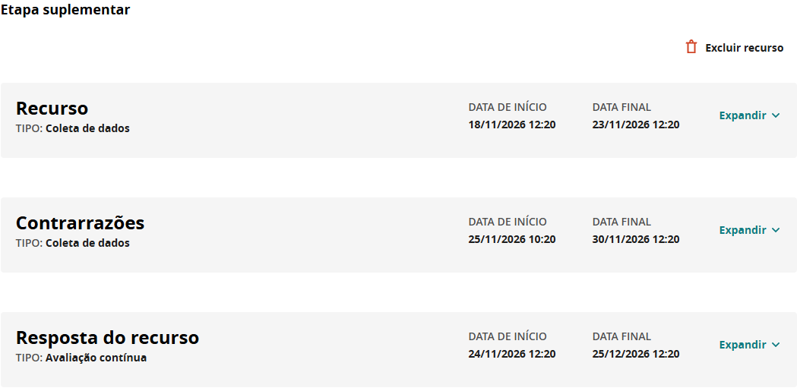 |  | 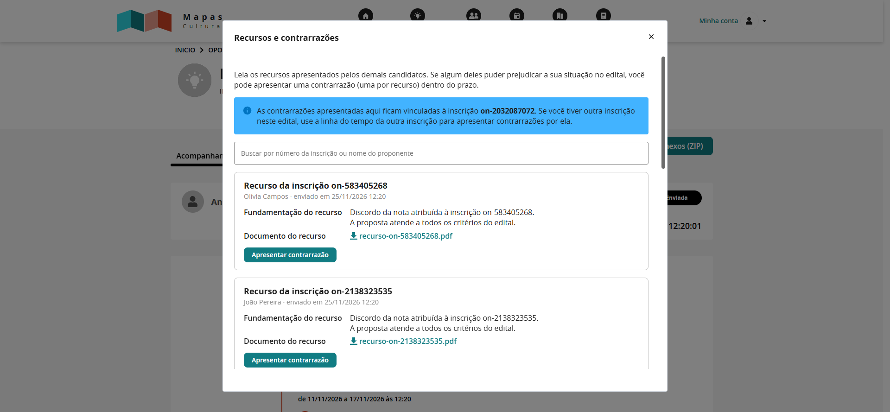 | 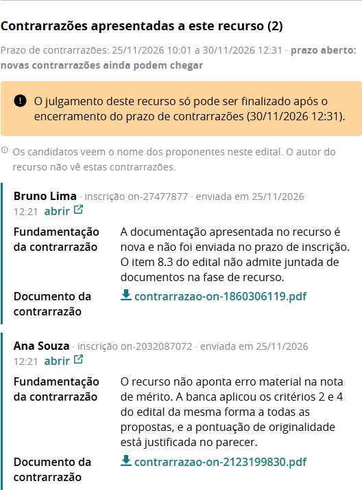 |

## Sumário

1. [Visão geral do fluxo](#visão-geral-do-fluxo)
2. [Gestor: configuração](#gestor-configuração)
3. [Candidato: ler os recursos e apresentar contrarrazão](#candidato-ler-os-recursos-e-apresentar-contrarrazão)
4. [Autor do recurso: contrarrazões recebidas](#autor-do-recurso-contrarrazões-recebidas)
5. [Avaliador: julgamento do recurso](#avaliador-julgamento-do-recurso)
6. [Nome dos proponentes: com e sem nomes](#nome-dos-proponentes-com-e-sem-nomes)
7. [Quem vê o quê](#quem-vê-o-quê)
8. [Regras](#regras)
9. [Requisitos](#requisitos)
10. [Instalação](#instalação)
11. [Como usar (passo a passo do gestor)](#como-usar-passo-a-passo-do-gestor)
12. [Modelo de dados](#modelo-de-dados)
13. [Referência técnica](#referência-técnica)
14. [Atualizações do Mapas](#atualizações-do-mapas)
15. [Testes](#testes)
16. [Limitações conhecidas](#limitações-conhecidas)
17. [Desinstalação](#desinstalação)

## Visão geral do fluxo

```
resultado preliminar da fase avaliada (ex.: Mérito)
        │
        ▼
prazo de recurso ──► candidatos enviam recursos (módulo nativo do Mapas)
        │
        ▼
prazo de contrarrazões (este plugin)
   • inscritos na mesma etapa leem os recursos e contestam
   • julgamento dos recursos e publicação do resultado TRAVADOS
        │
        ▼
fim do prazo ──► comissão julga cada recurso, vendo as contrarrazões
        │
        ▼
gestor publica o resultado da etapa de recurso
```

Quem participa:

| Papel | Onde trabalha | O que faz |
|---|---|---|
| **Gestor** do edital | Edição da oportunidade → aba *Configuração de fases* → *Etapa de recurso* → acordeão **Contrarrazões** | Cria a fase, define o prazo, monta o formulário, decide o que fica visível e acompanha as contrarrazões recebidas. |
| **Candidato** na etapa do recurso | *Minhas inscrições* → *Enviadas* → **Acompanhar** → linha do tempo → bloco **[Contrarrazões]** | Lê os recursos, apresenta contrarrazões e revê o que enviou. |
| **Autor do recurso** | O mesmo bloco **[Contrarrazões]** da linha do tempo, no item *Seu recurso* | Vê as contrarrazões que o recurso dele recebeu, **se o gestor permitir**. |
| **Avaliador** do recurso (comissão) | Tela de avaliação do recurso | Lê as contrarrazões antes de decidir. Só finaliza a avaliação depois do fim do prazo. |

## Gestor: configuração

Na edição da oportunidade, aba **Configuração de fases**, expanda a fase avaliada que tem recurso (por exemplo, o *Mérito*). Na *Etapa suplementar*, o plugin acrescenta o acordeão **Contrarrazões** entre **Recurso** e **Resposta do recurso**, no mesmo formato dos outros dois (tipo, datas e *Expandir*):


Ao expandir o acordeão (depois de clicar em **Adicionar contrarrazões**), o gestor encontra:


| Seção | O que é |
|---|---|
| **Configuração da fase** | Início e término do prazo de contrarrazões. Enquanto o prazo não termina (ou se não houver prazo), aparece o aviso de que o julgamento e a publicação do resultado estão travados. |
| **Campos do recurso visíveis para os candidatos** | Lista dos campos do formulário de recurso que podem ser publicados. Marque o que os candidatos poderão ler. Campos com dados pessoais (CPF, CNPJ, e-mail, telefone, endereço, dados bancários, pessoas, agentes e espaços) nem aparecem como opção. O número da inscrição é sempre exibido. |
| **Publicidade** | Duas opções: **Exibir o nome dos proponentes nos recursos e nas contrarrazões** (padrão: ligada) e **O autor do recurso pode ver as contrarrazões que o recurso dele recebeu** (padrão: desligada). Veja [com e sem nomes](#nome-dos-proponentes-com-e-sem-nomes) e [autor do recurso](#autor-do-recurso-contrarrazões-recebidas). |
| **Formulário da contrarrazão** | Mostra quantos campos o formulário tem. O plugin **não cria campos**: o gestor monta o formulário em **Configurar formulário** (abre o editor de formulário do Mapas numa nova aba). |
| **Salvamento** | **Não há botão "Salvar" nesta seção.** As alterações (datas, campos visíveis e publicidade) são salvas automaticamente cerca de 1,5 s depois da última mudança, como os demais campos da etapa de recurso. Aparece *Salvando...*, depois *Salvo.* e a mensagem *Modificações salvas*. O botão *Salvar* da barra inferior do Mapas continua servindo para os dados da oportunidade. |
| **Excluir contrarrazões** | Exclui a fase de contrarrazões e **todas** as contrarrazões recebidas, de forma definitiva (pede confirmação). |
| **Contrarrazões recebidas** | Tabela com número, autor, recurso contestado, situação (*Enviada* ou *Rascunho*), data de envio e o link **Ver** para a ficha completa. O gestor sempre vê os nomes. |

### Formulário ainda sem campos

Logo depois de criada, a fase não tem formulário. O acordeão avisa, e os candidatos **não conseguem iniciar** uma contrarrazão até o gestor criar ao menos um campo:

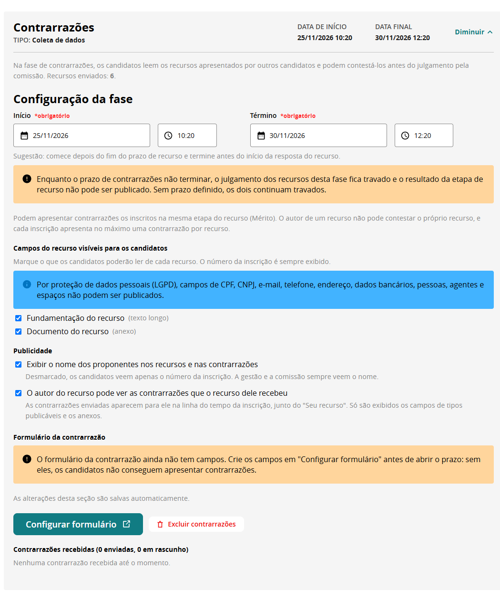

Enquanto isso, no modal dos candidatos, o botão *Apresentar contrarrazão* dá lugar a um aviso:


Sugestão de formulário: um campo de **texto longo obrigatório** (*Fundamentação da contrarrazão*) e um **anexo opcional**.

## Candidato: ler os recursos e apresentar contrarrazão

### Onde fica

1. **Minhas inscrições** → aba **Enviadas**. A página abre na aba *Não enviadas*, que costuma estar vazia.
2. No card da inscrição, **Acompanhar**.
3. Na linha do tempo, logo abaixo da fase que recebeu os recursos (o *Mérito*, no exemplo), aparece o bloco **[Contrarrazões]**.


O bloco mostra o prazo (com o selo *aberto* ou *encerrado*), quantos recursos foram apresentados, quantas contrarrazões a inscrição já enviou e, se houver, quantas foram iniciadas e não enviadas. O botão **Ver recursos e apresentar contrarrazão** (depois do prazo: **Ver recursos e contrarrazões**) abre o modal.

O bloco **só aparece** quando:

- a fase de contrarrazões existe e o prazo **já começou**;
- a inscrição está **na etapa do recurso** (quem foi eliminado antes não vê);
- quem está logado é o **dono da inscrição**.

### O modal


- O aviso azul lembra que a contrarrazão fica vinculada **a esta inscrição**. Quem tem mais de uma inscrição no edital usa a linha do tempo da outra para contestar por ela.
- A busca aparece a partir de 6 recursos.
- Cada recurso mostra o número da inscrição, o nome do proponente (se o gestor permitir), a data de envio, os campos liberados pelo gestor e os anexos para baixar.
- **Apresentar contrarrazão** cria a contrarrazão (rascunho) e leva ao formulário do Mapas.
- O recurso do próprio candidato aparece com o selo **Seu recurso** e não pode ser contestado.

### Preenchendo a contrarrazão

O formulário é o formulário de inscrição padrão do Mapas. O plugin acrescenta uma faixa no topo com o recurso contestado, o prazo e o link **Ver os recursos**, que volta à linha do tempo com o modal aberto:

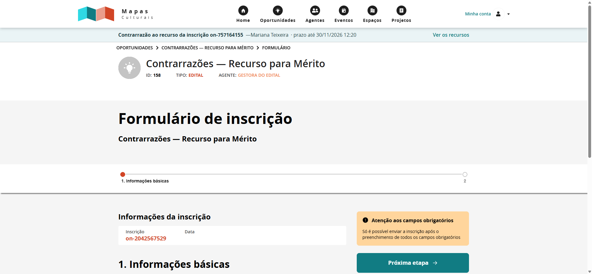

Enquanto não for enviada, a contrarrazão aparece no modal como rascunho, com o botão **Continuar contrarrazão**:

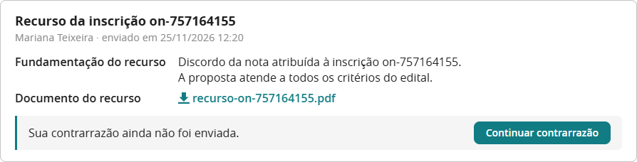

### Depois de enviar: "Exibir contrarrazão"

**Não há tela separada** para quem enviou. A contrarrazão enviada aparece no próprio modal, abaixo do recurso contestado, com os botões **Exibir contrarrazão** e **Ocultar contrarrazão**. O candidato vê tudo o que enviou, inclusive os próprios dados pessoais e os anexos:


Depois do envio, o Mapas leva o candidato para a ficha da inscrição. O plugin intercepta esse caminho e devolve o candidato à linha do tempo, com o modal aberto e a contrarrazão já expandida (`?contrarrazoes={fase}&contrarrazao={id}`). O mesmo acontece se ele abrir o endereço da contrarrazão por qualquer link. O gestor e a comissão continuam vendo a ficha normal.

## Autor do recurso: contrarrazões recebidas

É configurável, pela opção **O autor do recurso pode ver as contrarrazões que o recurso dele recebeu**, desligada por padrão.

**Ligada:** no modal, abaixo do *Seu recurso*, aparece **Contrarrazões recebidas por este recurso (N)**, com cada contrarrazão enviada e o botão **Exibir contrarrazão**. As contrarrazões aparecem assim que são enviadas, mesmo com o prazo aberto.

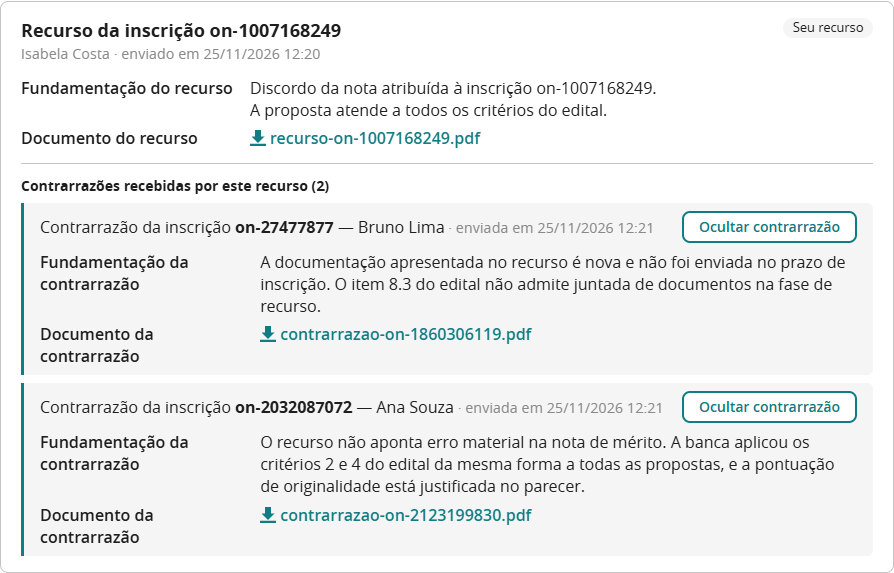

Para o autor do recurso, só são exibidos os campos de tipos publicáveis (os mesmos da lista de [LGPD](#regras)) e os anexos, que ele pode baixar. Se o gestor incluir no formulário da contrarrazão um campo de dados pessoais (CPF, e-mail, telefone etc.), esse campo continua visível para a comissão e para quem o preencheu, mas **não** chega ao autor do recurso.

**Desligada:** o autor do recurso vê só o próprio recurso. Ele também não consegue abrir a contrarrazão nem baixar os anexos dela por link direto.


## Avaliador: julgamento do recurso

O avaliador abre o recurso pela tela de avaliação do Mapas (*Painel* → *Minhas avaliações* → recurso → **Acessar**). O plugin acrescenta, abaixo do conteúdo do recurso, o bloco **Contrarrazões apresentadas a este recurso**. O formulário de avaliação continua na coluna da direita:

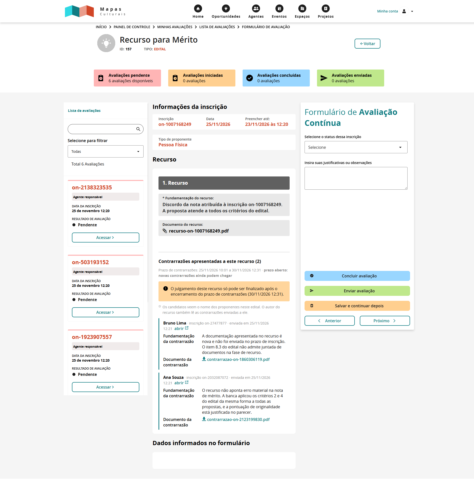

O bloco mostra:

| Item | Descrição |
|---|---|
| Título com a contagem | Quantas contrarrazões **enviadas** o recurso recebeu. Rascunhos não aparecem. |
| Prazo de contrarrazões | Início e término. Com o prazo aberto: *prazo aberto: novas contrarrazões ainda podem chegar*. |
| Aviso amarelo da trava | Com o prazo aberto (ou sem prazo), avisa que o julgamento só pode ser finalizado depois do término. Some quando o prazo acaba. |
| Linha de publicidade (ⓘ) | Diz ao avaliador **o que os candidatos estão vendo** neste edital: se veem os nomes e se o autor do recurso lê as contrarrazões. |
| Cada contrarrazão | Nome do autor, número da inscrição, data de envio, link **abrir** (ficha completa) e **todos os campos**, inclusive dados pessoais e anexos. |

**Com o prazo aberto** (no exemplo, nomes visíveis aos candidatos e opção do autor do recurso desligada):


Nesse período o avaliador pode ler e salvar rascunho do parecer (*Salvar e continuar depois*). Se tentar **Concluir avaliação** ou **Enviar avaliação**, recebe a mensagem *"O julgamento deste recurso só pode ser finalizado após o encerramento do prazo de contrarrazões (data)."*

**Depois do prazo**, o aviso da trava desaparece e a avaliação segue normalmente:

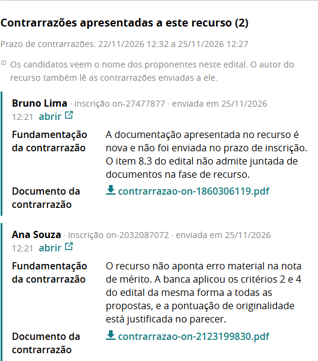

O avaliador **sempre vê o nome** de quem contestou, mesmo quando o edital esconde os nomes dos candidatos. Veja a comparação abaixo.

## Nome dos proponentes: com e sem nomes

É configurável, pela opção **Exibir o nome dos proponentes nos recursos e nas contrarrazões**, ligada por padrão. A opção vale para tudo o que os **candidatos** veem. Gestão e comissão sempre veem os nomes.

### Lista de recursos (candidato)

| Com nomes | Sem nomes |
|---|---|
|  |  |
| Abaixo do número, *nome · enviado em*. A busca aceita número ou nome. | Só *enviado em*. A busca passa a ser **só por número**. |

### Recurso com a contrarrazão enviada (candidato)

| Com nomes | Sem nomes |
|---|---|
|  | 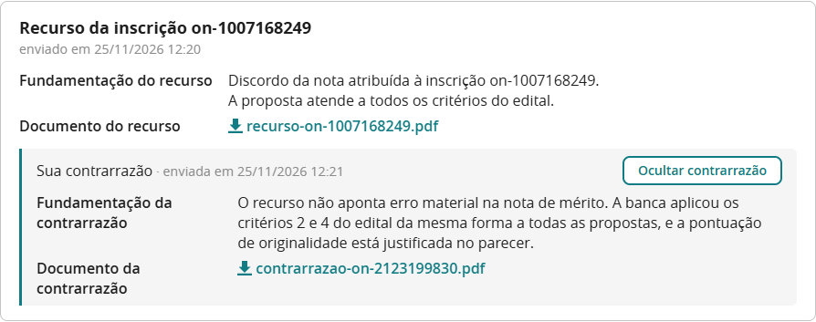 |

### Faixa do formulário da contrarrazão (candidato)

| Com nome |
|---|
|  |
| **Sem nome** |
|  |

### Contrarrazões recebidas (autor do recurso)

| Com nomes | Sem nomes |
|---|---|
|  | 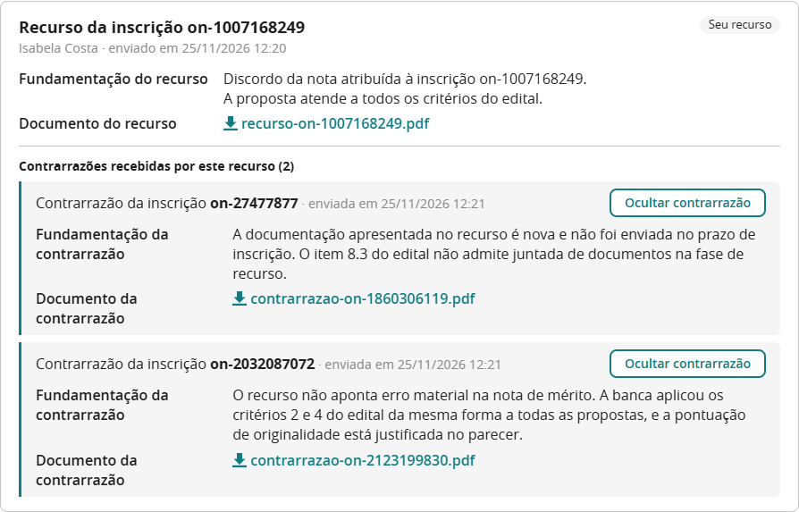 |
| *Contrarrazão da inscrição on-… — Bruno Lima* | *Contrarrazão da inscrição on-…* |

O autor do recurso sempre vê o **próprio** nome no *Seu recurso*.

### Avaliador (comissão)

| Edital com nomes | Edital sem nomes |
|---|---|
|  | 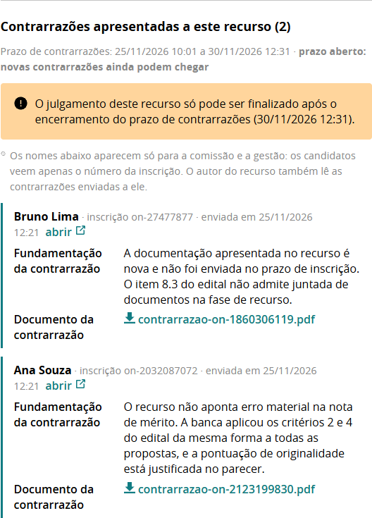 |
| *Os candidatos veem o nome dos proponentes neste edital.* | *Os nomes abaixo aparecem só para a comissão e a gestão: os candidatos veem apenas o número da inscrição.* |

Nos dois casos o avaliador vê os nomes. Só muda a linha ⓘ, que explica o que os candidatos veem. Nas capturas, a segunda parte da frase também muda, porque a opção do autor do recurso estava desligada na da esquerda e ligada na da direita.

## Quem vê o quê

| Informação | Gestor | Avaliador do recurso | Candidato na etapa | Autor do recurso | Eliminado / outros |
|---|---|---|---|---|---|
| Lista de recursos | sim (pela tabela e fichas) | — | sim, a partir do início do prazo | sim (inclui o *Seu recurso*) | não |
| Campos do recurso | todos | todos | só os liberados pelo gestor | os do próprio recurso | não |
| Nome do autor do recurso | sim | sim | **configurável** | o próprio | não |
| Conteúdo da contrarrazão | todos os campos | todos os campos | só as que **ele mesmo** enviou | **configurável**; só campos publicáveis e anexos | não |
| Nome de quem contestou | sim | sim | o próprio | **configurável** | não |
| Ficha da contrarrazão (`/inscricao/{id}/`) | sim | sim | o autor é levado de volta ao modal | só com a opção ligada (sem dados privados) | não |

## Regras

| Regra | Como funciona |
|---|---|
| Quem pode apresentar | Somente inscrições **enviadas** que estão na **mesma etapa do recurso**, ou seja, na fase avaliada que recebeu o recurso (por exemplo, o *Mérito*). Quem foi eliminado antes dessa etapa não vê o bloco nem os recursos. Não é configurável. |
| Uma por recurso | Cada inscrição apresenta no máximo uma contrarrazão por recurso. Pode contestar vários recursos. |
| Próprio recurso | O autor não contesta o próprio recurso. Os recursos de qualquer inscrição do mesmo usuário aparecem como *Seu recurso*. |
| Prazo | Uma contrarrazão só pode ser iniciada dentro do prazo. A lista de recursos aparece a partir do início do prazo e continua disponível depois dele, para consulta. Contrarrazão já iniciada continua acessível depois do prazo. |
| Formulário | O plugin não cria campos. Sem ao menos um campo no formulário, ninguém consegue iniciar uma contrarrazão. |
| Trava do julgamento | Enquanto o prazo de contrarrazões não terminar, a comissão não conclui nem envia a avaliação do recurso. Ninguém defere ou indefere o recurso: nem pela mudança de status, nem pelo chat da avaliação contínua, nem pela aplicação em lote. Sem prazo definido, tudo continua travado. Rascunhos de parecer são permitidos. |
| Publicação do resultado | Com o prazo de contrarrazões aberto (ou sem prazo), o **resultado da etapa de recurso não é publicado**, nem pelo botão de publicar, nem pela publicação agendada. A publicação agendada que cair dentro do prazo é recusada e registrada no log. O gestor publica de novo depois do prazo. |
| Contrarrazões para o autor do recurso | Configurável (padrão: não). Ligada, o autor do recurso vê as contrarrazões **enviadas** ao recurso dele, só com campos de tipos publicáveis e anexos. |
| Nomes | Configurável (padrão: exibe). Desligada, os candidatos veem só o número da inscrição. Gestão e comissão sempre veem o nome. |
| LGPD | Campos de CPF, CNPJ, e-mail, telefone, endereço, dados bancários, pessoas, agentes e espaços **nunca** são publicados aos outros candidatos, nem nos recursos nem nas contrarrazões. |
| Visibilidade | A página pública do edital não mostra a lista. Só quem pode apresentar contrarrazão (e os gestores) vê o conteúdo dos recursos e baixa os anexos liberados. |

## Requisitos

- Mapas Culturais **7.8.x**, com o tema **BaseV2**. Testado na **7.8.21** e na **7.8.22**. A 7.6.x não é suportada. A versão 1.3.0 também foi conferida num Mapas **7.7.66** (ambiente de desenvolvimento): o plugin registra um aviso no log, mas funciona.
- O módulo nativo de recurso (`OpportunityAppealPhase`), com a fase de recurso criada na oportunidade.
- Acesso para editar a configuração do Mapas e reiniciar o PHP (ou os contêineres).

O plugin **não cria tabelas** e **não precisa de `db-update`**. Ele usa as entidades do próprio Mapas (oportunidade, inscrição e metadados).

## Instalação

O plugin precisa ficar na pasta `src/plugins/Contrarrazoes` do Mapas. O nome da pasta tem que ser exatamente `Contrarrazoes`, porque é também o namespace PHP do plugin.

### A) Instalação direta (sem Docker)

1. **Baixe o plugin** para a pasta de plugins do Mapas:

   ```bash
   cd /caminho/do/mapas/src/plugins
   git clone https://github.com/yanlfs08/mapas-plugin-contrarrazoes.git Contrarrazoes
   ```

2. **Ative o plugin** na configuração. Abra o arquivo de configuração de plugins que a sua instalação usa (por exemplo, `config/plugins.php` ou um arquivo dentro de `config/*.d/`) e acrescente `Contrarrazoes` à lista, **sem remover os plugins que já existem**:

   ```php
   <?php
   return [
       'plugins' => [
           'MultipleLocalAuth' => ['namespace' => 'MultipleLocalAuth'],
           // ... outros plugins já ativos
           'Contrarrazoes' => ['namespace' => 'Contrarrazoes'],
       ],
   ];
   ```

3. **Recompile os assets**, se a sua instalação compila os componentes com `pnpm`:

   ```bash
   cd /caminho/do/mapas/src
   pnpm install --recursive && pnpm run build
   ```

4. **Limpe o cache e reinicie o PHP:**

   ```bash
   redis-cli FLUSHALL                  # se o cache do Mapas estiver no Redis
   sudo systemctl reload php8.3-fpm    # ajuste para a versão do seu PHP-FPM
   ```

5. [Confira se o plugin está ativo](#conferindo-se-o-plugin-está-ativo).

### B) Instalação com Docker (projeto base do Mapas)

No [projeto base do Mapas](https://github.com/mapasculturais/mapasculturais-base-project), a imagem é gerada a partir de `docker/Dockerfile`, que **copia** a pasta `plugins/` e a configuração para dentro da imagem:

```dockerfile
FROM hacklab/mapasculturais:latest

COPY themes /var/www/src/themes
COPY plugins /var/www/src/plugins

WORKDIR /var/www/src
RUN pnpm install --recursive && pnpm run build
WORKDIR /var/www

COPY docker/common/config.d /var/www/config/common.d
COPY docker/production/config.d /var/www/config/config.d
```

Por isso, toda instalação ou atualização do plugin exige **gerar a imagem de novo**.

1. **Baixe o plugin** para a pasta `plugins/` do projeto:

   ```bash
   cd /caminho/do/projeto-base/plugins
   git clone https://github.com/yanlfs08/mapas-plugin-contrarrazoes.git Contrarrazoes
   ```

2. **Ative o plugin** em `docker/common/config.d/plugins.php`:

   ```php
   <?php
   return [
       'plugins' => [
           'MultipleLocalAuth' => ['namespace' => 'MultipleLocalAuth'],
           'SamplePlugin' => ['namespace' => 'SamplePlugin'],
           'SpamDetector',
           'Contrarrazoes' => ['namespace' => 'Contrarrazoes'],
       ],
   ];
   ```

3. **Confira o `docker/Dockerfile`.** As linhas `COPY plugins ...` e `COPY docker/common/config.d ...` precisam estar presentes e sem caracteres soltos (um `'` perdido no começo de uma linha quebra o build).

4. **Gere a imagem e recrie o contêiner da aplicação:**

   ```bash
   cd /caminho/do/projeto-base
   docker compose build mapasculturais
   docker compose up -d mapasculturais
   ```

5. **Limpe o cache** (o Redis de cache do projeto base se chama `redis`):

   ```bash
   docker compose exec redis redis-cli FLUSHALL
   ```

6. [Confira se o plugin está ativo](#conferindo-se-o-plugin-está-ativo).

> **Alternativa para desenvolvimento:** em vez de gerar a imagem a cada mudança, monte a pasta do plugin como volume no serviço `mapasculturais` do `docker-compose.yml`:
>
> ```yaml
>     volumes:
>       - ./plugins/Contrarrazoes:/var/www/src/plugins/Contrarrazoes
> ```
>
> Com o volume, mudanças em PHP valem depois de limpar o cache. Mudanças em JavaScript ou CSS dos componentes exigem recompilar os assets dentro do contêiner (`pnpm run build` em `/var/www/src`).

> **Docker Desktop no Windows (WSL):** depois de reiniciar o Docker Desktop, os contêineres podem falhar com *"error mounting ... not a directory"* ou subir com o banco **vazio**, porque os bind mounts não foram restaurados. Os dados continuam na pasta do host. Rode `docker compose down` e `docker compose up -d` para recriar os contêineres.

### Conferindo se o plugin está ativo

1. **Arquivos no lugar** (no Docker, dentro do contêiner):

   ```bash
   docker compose exec mapasculturais ls /var/www/src/plugins
   # deve listar: Contrarrazoes
   docker compose exec mapasculturais grep "VERSION =" /var/www/src/plugins/Contrarrazoes/Plugin.php
   # const VERSION = '1.3.0';
   ```

2. **Metadados registrados.** A API de descrição das oportunidades passa a listar os campos do plugin:

   ```bash
   curl -s http://localhost/api/opportunity/describe | grep -o 'counterAppeal[A-Za-z]*' | sort -u
   # counterAppealEligibility, counterAppealOf, counterAppealPhase, counterAppealPublicFields,
   # counterAppealShowNames, counterAppealVisibleToAppellant
   ```

3. **Log sem erros.** No projeto base, o log da aplicação fica em `docker-data/logs/app.log`. Se a versão do Mapas estiver fora da faixa testada, aparece o aviso *"Plugin Contrarrazoes ... foi testado com o Mapas Culturais 7.8.x"*.

4. **Na tela:** abra uma oportunidade que tenha fase de recurso, aba **Configuração de fases**, expanda a fase avaliada e confira o acordeão **Contrarrazões** entre *Recurso* e *Resposta do recurso*.

### Configurações opcionais

Para mudar o comportamento padrão, informe `config` na ativação do plugin:

```php
'plugins' => [
    'Contrarrazoes' => [
        'namespace' => 'Contrarrazoes',
        'config' => [
            // trava o julgamento dos recursos e a publicação do resultado da etapa de recurso
            // até o fim do prazo de contrarrazões (padrão: true)
            'lockAppealJudgement' => true,

            // tipos de campo que podem ser publicados aos candidatos (recursos e contrarrazões)
            'publicFieldTypes' => ['text', 'textarea', 'select', 'checkboxes', 'checkbox', 'number',
                                   'currency', 'date', 'url', 'links', 'custom-table', 'municipio'],
        ],
    ],
],
```

| Chave | Padrão | Efeito |
|---|---|---|
| `lockAppealJudgement` | `true` | Com `false`, a comissão julga os recursos e o gestor publica o resultado mesmo com o prazo de contrarrazões aberto. |
| `publicFieldTypes` | lista acima | Tipos de campo do formulário de recurso que aparecem como opção de publicação, e tipos de campo da contrarrazão mostrados ao autor do recurso. Não acrescente tipos com dados pessoais. |

A configuração `defaultFieldTitle` das versões anteriores foi removida na 1.3.0, porque o plugin não cria mais o campo do formulário.

As opções de **nomes** e de **visibilidade para o autor do recurso** não ficam aqui: elas são **por edital**, no acordeão *Contrarrazões*.

### Atualizando o plugin

```bash
cd /caminho/para/plugins/Contrarrazoes
git pull
```

Depois repita o passo de reiniciar. Na **instalação direta**, recompile os assets e recarregue o PHP. No **Docker**, rode `docker compose build mapasculturais && docker compose up -d mapasculturais`. Nos dois casos, limpe o cache. Leia o `CHANGELOG.md` antes de atualizar.

Ao atualizar para a **1.3.0**:

- fases de contrarrazões já existentes mantêm o formulário que tinham (o campo criado automaticamente pelas versões antigas continua lá);
- elas passam a exibir os nomes (padrão) e a **não** mostrar as contrarrazões ao autor do recurso (padrão), até o gestor mudar;
- a 1.3.0 parte da 1.1.0 e **não inclui** a resposta do avaliador às contrarrazões da 1.2.0. Os metadados gravados pela 1.2.0 (`counterAppealResponses`, `counterAppealResponseResults`) ficam no banco e são ignorados.

### Problemas comuns

| Sintoma | Causa provável e solução |
|---|---|
| O acordeão *Contrarrazões* não aparece | Plugin não ativado ou imagem antiga. Confira os passos de ativação e reinício. No Docker, o `git pull` sozinho não muda nada: é preciso gerar a imagem de novo. |
| O acordeão aparece no fim da *Etapa de recurso*, e não entre *Recurso* e *Resposta do recurso* | Uma atualização do Mapas mudou a marcação do componente de recurso. O plugin continua funcionando e registra um aviso no log. Veja [Atualizações do Mapas](#atualizações-do-mapas). |
| O candidato não vê o bloco *[Contrarrazões]* | A inscrição não está na etapa do recurso (foi eliminada antes), o prazo ainda não começou, a fase de contrarrazões não foi criada, ou ele está olhando a aba *Não enviadas* de *Minhas inscrições*. |
| O candidato vê os recursos, mas não o botão *Apresentar contrarrazão* | O formulário da contrarrazão ainda não tem campos (aparece um aviso no lugar do botão), o prazo terminou, ou ele já contestou aquele recurso. |
| O candidato é levado para a edição do perfil | Comportamento do Mapas: perfil incompleto (descrição curta, área de atuação) redireciona para a edição. Não é do plugin. |
| A comissão não consegue concluir a avaliação do recurso | É a trava do julgamento: o prazo de contrarrazões ainda não terminou ou não foi definido. |
| O resultado da etapa de recurso não é publicado | É a trava da publicação: o prazo de contrarrazões ainda não terminou ou não foi definido. Uma publicação agendada para dentro do prazo também é recusada (veja o log); publique de novo depois do prazo. |
| Mudanças de configuração demoram a valer | Limpe o cache (Redis). |

## Como usar (passo a passo do gestor)

1. **Crie a fase de recurso** normalmente, em *Configuração de fases*, e deixe os candidatos enviarem os recursos.
2. Na mesma aba, expanda a fase que tem recurso. Na *Etapa de recurso*, abra o acordeão **Contrarrazões** e clique em **Adicionar contrarrazões**.
3. **Monte o formulário** em **Configurar formulário** (por exemplo, um texto longo obrigatório e um anexo). Sem formulário, os candidatos não conseguem apresentar contrarrazões.
4. Defina o **prazo**, de preferência começando depois do fim do prazo de recurso e terminando antes da resposta do recurso.
5. Marque os **campos do recurso visíveis** e decida a **publicidade**: exibir ou não os nomes, e se o autor do recurso vê as contrarrazões. Não há botão de salvar: as alterações são salvas automaticamente.
6. **Divulgue** a abertura do prazo, explicando o caminho: *Minhas inscrições* → *Enviadas* → *Acompanhar* → bloco *[Contrarrazões]*.
7. Acompanhe as contrarrazões na tabela do acordeão.
8. Quando o prazo terminar, a comissão julga os recursos, já com as contrarrazões na tela de avaliação, e o gestor publica o resultado da etapa de recurso como de costume.

Cronograma sugerido: resultado preliminar → prazo de recurso → prazo de contrarrazões → julgamento dos recursos → resultado final. Se usar a **publicação agendada** do resultado da etapa de recurso, agende para depois do fim do prazo de contrarrazões.

## Modelo de dados

O plugin não cria tabelas. Tudo fica em entidades nativas do Mapas:

| O quê | Onde fica |
|---|---|
| Fase de contrarrazões | Uma `Opportunity` **oculta de primeiro nível** (sem `parent`, status `-1`, fora das listagens), com os metadados `isCounterAppealPhase`, `counterAppealOf`, `counterAppealPublicFields`, `counterAppealShowNames` e `counterAppealVisibleToAppellant`. A fase de recurso guarda o vínculo em `counterAppealPhase`. |
| Formulário da contrarrazão | Uma `RegistrationStep` (criada vazia com a fase) e os campos que o gestor cria pelo editor de formulário do Mapas. |
| Contrarrazão | Uma `Registration` nessa oportunidade, com os metadados `counterAppealTarget` (id da inscrição de recurso contestada) e `counterAppealAuthorNumber` (número da inscrição autora no edital). |

Por que **primeiro nível**: a página da inscrição (`registration/single.php`) usa `$entity->firstPhase`. Se a fase de contrarrazões fosse filha da fase de recurso, a página da contrarrazão quebraria.

Por que **status `-1`**: o Mapas só permite ver e enviar inscrições em oportunidades com status `-1`, `1` ou `-20`. O `-20` dispara a lógica nativa de recurso, e o `1` faria a fase aparecer nas buscas.

- Excluir a fase de contrarrazões (acordeão *Contrarrazões*) apaga **definitivamente** as contrarrazões recebidas.
- Excluir a fase de recurso também exclui a fase de contrarrazões.
- Se a fase de recurso for para a lixeira, as contrarrazões ficam inativas, mas não são apagadas.
- Os anexos das contrarrazões são arquivos **privados** do Mapas (`/file/arquivo-privado/{id}/`). O download passa pela checagem de permissão da contrarrazão.

## Referência técnica

Esta seção explica cada peça do plugin. Toda a lógica está em `Plugin.php`. As telas usam componentes Vue no padrão do tema BaseV2.

### Estrutura de arquivos

```
Contrarrazoes/
├── Plugin.php                                  toda a lógica (metadados, permissões, endpoints, trava, telas)
├── assets/css/contrarrazoes.css                estilos dos componentes
├── components/
│   ├── counter-appeal-config/                  acordeão "Contrarrazões" do gestor (salvamento automático)
│   │   ├── template.php
│   │   ├── script.js
│   │   └── texts.php
│   ├── counter-appeal-timeline/                bloco "[Contrarrazões]" na linha do tempo do candidato
│   │   ├── template.php
│   │   └── script.js
│   ├── counter-appeal-list/                    lista de recursos, "Exibir contrarrazão" e contrarrazões recebidas (no modal)
│   │   ├── template.php
│   │   ├── script.js
│   │   └── texts.php
│   └── counter-appeal-evaluation/              bloco da comissão na avaliação do recurso
│       ├── template.php
│       └── script.js
├── layouts/parts/contrarrazoes/
│   ├── evaluation-block.php                    encaixa counter-appeal-evaluation na tela da comissão
│   └── registration-banner.php                 faixa com o recurso contestado no formulário da contrarrazão
├── tests/                                      cenário e testes (API e navegador)
├── docs/capturas/                              imagens deste README
├── CHANGELOG.md
└── CLAUDE.md                                   contexto e armadilhas para manutenção
```

### Metadados registrados

Registrados em `Plugin::register()`.

| Entidade | Metadado | Tipo | Para que serve |
|---|---|---|---|
| Opportunity | `isCounterAppealPhase` | boolean | Marca a oportunidade oculta como fase de contrarrazões. |
| Opportunity | `counterAppealOf` | integer | Na fase de contrarrazões: id da fase de recurso a que ela pertence. |
| Opportunity | `counterAppealPhase` | integer | Na fase de recurso: id da fase de contrarrazões ligada a ela. |
| Opportunity | `counterAppealPublicFields` | json | Nomes dos campos do recurso que os candidatos podem ler (`field_N` e grupos de anexo `rfc_N`). |
| Opportunity | `counterAppealShowNames` | boolean | **1.3.0.** Exibe o nome dos proponentes aos candidatos. Sem valor gravado (fases antigas) = exibe. |
| Opportunity | `counterAppealVisibleToAppellant` | boolean | **1.3.0.** O autor do recurso vê as contrarrazões recebidas. Sem valor = não vê. |
| Opportunity | `counterAppealEligibility` | select | **Obsoleto desde a 1.1.0.** Continua registrado para não quebrar fases antigas, mas é ignorado: a regra é sempre a mesma etapa do recurso. |
| Registration | `counterAppealTarget` | integer | Na contrarrazão: id da inscrição de recurso contestada. |
| Registration | `counterAppealAuthorNumber` | string | Na contrarrazão: número da inscrição autora no edital (permite uma contrarrazão por recurso **por inscrição**). |

### Endpoints

Todos são ações nos controladores existentes do Mapas (hooks `POST(...)` e `GET(...)`). No JavaScript, use `entity.invoke(acao, dados)`. Todos exigem login.

| Endpoint | Quem pode | O que faz |
|---|---|---|
| `POST /opportunity/createCounterAppealPhase/{id da fase de recurso}` | gestor (`@control` na fase de recurso) | Cria a fase de contrarrazões, só com a etapa vazia do formulário (sem campos). Nomes visíveis e contrarrazões ocultas ao autor do recurso, por padrão. Se a fase já existir, devolve a existente. Resposta: a fase serializada. |
| `POST /opportunity/saveCounterAppealConfig/{id da fase de contrarrazões}` | gestor | Salva qualquer combinação de `registrationFrom`, `registrationTo`, `counterAppealPublicFields`, `counterAppealShowNames` e `counterAppealVisibleToAppellant`. Valida as datas (o término não pode ser anterior ao início; vazio apaga a data) e descarta campos que não podem ser publicados. Ignora `counterAppealEligibility`. Limpa o cache de permissões. É chamado pelo salvamento automático do acordeão. |
| `POST /opportunity/deleteCounterAppealPhase/{id}` | gestor | Desfaz o vínculo com a fase de recurso e exclui definitivamente a fase e as contrarrazões. |
| `GET /opportunity/counterAppealFile/{id da fase}/file:{id do arquivo}` | gestor ou inscrito na etapa | Baixa um anexo **de recurso** marcado como público, depois do início do prazo. Qualquer outro caso responde 403. |
| `POST /opportunity/createCounterAppealRegistration/{id da fase}` | inscrito na etapa | Dados: `appeal_registration_id` e `author_registration_id`. Valida as regras. Devolve a contrarrazão existente daquela inscrição para aquele recurso ou, dentro do prazo e **com o formulário configurado**, cria uma nova (rascunho). |

### Pontos de encaixe nas telas

Registrados em `Plugin::initTemplateHooks()` e em `_init()`.

| Hook | O que faz |
|---|---|
| `template(opportunity.edit.tabs):end` | Na edição da oportunidade, monta `$MAPAS.config.counterAppealConfig` (uma entrada por fase de recurso, com a fase de contrarrazões, os campos publicáveis e as contrarrazões recebidas) e importa `counter-appeal-config`. Não imprime nada. |
| `mapas.printJsObject:after` (prioridade 5) | Insere `<counter-appeal-config>` no template do componente nativo `opportunity-appeal-phase-config`, entre os acordeões *Recurso* e *Resposta do recurso*, antes de os templates irem para a página. O componente nativo não tem ponto de encaixe ali, e o plugin **não copia** o template do núcleo. Veja `injectCounterAppealConfig()`. |
| `template(registration.<<view\|single>>.single-tab):begin` | Na página da inscrição, só para o dono, monta `$MAPAS.config.counterAppealList` com os dados das fases de contrarrazões para **essa** inscrição (recursos, contrarrazões dela com o conteúdo enviado e, se liberado, as contrarrazões recebidas). Não imprime nada. |
| `component(opportunity-phases-timeline).item:end` | Coloca `<counter-appeal-timeline>` no fim de cada item da linha do tempo. O componente só se mostra no item da fase avaliada que recebeu recurso. Mesmo padrão do módulo nativo `OpportunityExecution`. |
| `template(registration.<<view\|edit\|single>>.main-header):after` | No formulário e na ficha de uma contrarrazão, mostra a faixa `registration-banner.php` com o recurso contestado (com ou sem o nome, conforme a configuração), o prazo e o link de volta para a lista. |
| `template(registration.evaluation.registration-appealPhase-evaluation-view):after` | Na avaliação do recurso, monta `$MAPAS.config.counterAppealEvaluation` (contrarrazões enviadas, prazo, trava e o que os candidatos veem) e mostra `counter-appeal-evaluation`. |
| `GET(registration.<<view\|single>>):before` | **1.3.0.** Quando o dono abre uma contrarrazão **enviada** (inclusive logo depois do envio), redireciona para a linha do tempo da inscrição autora, com o modal aberto e a contrarrazão expandida. Gestores continuam na ficha. |
| `GET(opportunity.<<single\|edit>>):before` | A fase de contrarrazões não tem página própria. Quem abre o endereço dela vai para a *Configuração de fases* (gestor), para a linha do tempo da inscrição com a lista aberta (candidato na etapa) ou para a página do edital (demais). |
| `app.init:after` | Carrega `assets/css/contrarrazoes.css`. |

### Hooks de permissão e de trava

Registrados em `initPermissionHooks()`, `initJudgementLockHooks()` e `_init()`.

| Hook | O que faz |
|---|---|
| `can(Opportunity.<<@control\|modify\|view\|...>>)` | Quem controla a fase de recurso controla a fase de contrarrazões. |
| `entity(Opportunity).permissionCacheUsers` | Inclui os gestores do edital no cache de permissões da fase de contrarrazões. |
| `entity(Registration).<<insert\|send>>:before` | Impede criar ou enviar uma inscrição na fase de contrarrazões sem `counterAppealTarget`, ou seja, fora do endpoint `createCounterAppealRegistration`. |
| `can(Registration.<<view\|viewPrivateData\|viewPrivateFiles\|viewConsolidatedResult>>)` | Gestores do edital e a comissão (quem pode ver o recurso contestado, **exceto o próprio autor do recurso**) veem a contrarrazão inteira e seus anexos. |
| `can(Registration.<<view\|viewPrivateFiles>>)` | **1.3.0.** O autor do recurso vê a contrarrazão **enviada** e baixa os anexos dela só se `counterAppealVisibleToAppellant` estiver ligado. Nunca recebe `viewPrivateData`. |
| `POST(registration.<<saveEvaluation\|saveEvaluationAndChangeStatus\|sendEvaluation>>):before` | Trava: bloqueia concluir ou enviar a avaliação do recurso dentro do prazo. Rascunhos passam. |
| `entity(RegistrationEvaluation).save:before` | Trava: proteção extra para qualquer outro caminho que grave uma avaliação finalizada. Libera a trava de gravação do Mapas antes de recusar. |
| `entity(ChatMessage).insert:before` | Trava: impede decidir o recurso pelo chat da avaliação contínua. |
| `entity(Registration).save:before` | Trava: impede mudar o status do recurso (deferir ou indeferir) dentro do prazo. O envio do recurso pelo candidato (rascunho → enviado) continua permitido. |
| `POST(opportunity.applyEvaluationsContinuous):before` | Trava: recusa a aplicação em lote da avaliação contínua antes de começar, com mensagem clara. |
| `ALL(opportunity.publishRegistrations):before` | **1.3.0.** Trava da publicação: recusa publicar o resultado da fase de recurso dentro do prazo (resposta 403 com a mensagem para o gestor). |
| `entity(Opportunity).publishRegistrations:before` | **1.3.0.** Trava da publicação para qualquer outro caminho, como a publicação agendada (job `PublishResult`). Desfaz a transação aberta pelo núcleo, registra um aviso no log e recusa. |
| `entity(Opportunity).destroy:before` | Ao excluir a fase de recurso, agenda a exclusão da fase de contrarrazões para o fim da requisição. |

As regras que dependem de data (prazo e trava) **não** ficam em hooks `can(...)`, porque o Mapas guarda o resultado desses hooks em cache por até um dia. As permissões que dependem da configuração do edital (autor do recurso) ficam em `can(...)`, e o salvamento da configuração limpa o cache das contrarrazões.

### Funções da classe `Plugin`

**Configuração e inicialização**

| Função | O que faz |
|---|---|
| `__construct(array $config)` | Aplica os valores padrão de `publicFieldTypes` e `lockAppealJudgement`. |
| `_init()` | Verifica a versão do Mapas, carrega o CSS e registra os hooks (permissões, endpoints, trava, telas), o redirecionamento da URL da fase, o redirecionamento da ficha da contrarrazão e a exclusão em cascata. |
| `register()` | Registra os metadados da tabela [Metadados registrados](#metadados-registrados). |
| `checkMapasVersion()` | Lê o `version.txt` do Mapas e grava um aviso no log se a versão não for 7.8.x. |

**Consultas**

| Função | O que faz |
|---|---|
| `meta($entity, $key)` (estática) | Lê um metadado sem passar pela checagem de dados privados. Dentro de hooks `can(...)`, ler `$entity->chave` causaria recursão infinita. |
| `isOwnedBy($registration, $user)` (estática) | **1.3.0.** Verdadeiro se a inscrição pertence ao usuário (por qualquer agente dele). |
| `getCounterAppealPhase($appeal_phase)` | Fase de contrarrazões de uma fase de recurso, ou `null`. |
| `getAppealPhase($counter)` | Fase de recurso de uma fase de contrarrazões, ou `null` se ela estiver na lixeira ou não existir. |
| `getAppealPhasesOfOpportunity($opportunity)` | Todas as fases de recurso do edital, na ordem das fases. |
| `getEligibilityBasePhase($counter)` | Fase que define quem pode contestar: sempre a fase avaliada que recebeu o recurso. |
| `getUserCandidateRegistrations($counter, $user)` | Inscrições **enviadas** do usuário nessa fase avaliada. São as inscrições que podem apresentar contrarrazão. |
| `getSentAppeals($appeal_phase)` | Recursos enviados na fase de recurso, por data de envio. |
| `getCounterAppeals($counter, $appeal, $min_status)` | Contrarrazões da fase, filtradas opcionalmente por recurso e por status mínimo. |
| `findCounterAppealBy($counter, $appeal, $author_number)` | Contrarrazão que uma inscrição (pelo número) já apresentou a um recurso. |
| `findAuthorRegistration($counter, $number)` | Inscrição do edital com um número, primeiro na fase avaliada e depois na primeira fase. |
| `isCounterAppealListVisible($counter)` | Verdadeiro a partir do início do prazo. |
| `showNames($counter)` | **1.3.0.** Configuração de nomes da fase (padrão: verdadeiro). |
| `isVisibleToAppellant($counter)` | **1.3.0.** Configuração do autor do recurso (padrão: falso). |
| `isAppealJudgementLocked($appeal_phase)` | Verdadeiro enquanto o prazo de contrarrazões não terminar (ou não estiver definido), se `lockAppealJudgement` estiver ligado. Vale para o julgamento e para a publicação. |
| `getJudgementLockMessage($appeal_phase)` | Mensagem da trava do julgamento, com a data de término quando houver. |
| `getPublishLockMessage($appeal_phase)` | **1.3.0.** Mensagem da trava da publicação, com a data de término quando houver. |

**Regras**

| Função | O que faz |
|---|---|
| `getCounterAppealDenialReason($counter, $author, $appeal, $user)` | Valida se a inscrição autora pode contestar o recurso: o recurso pertence à fase e foi enviado, a autora é do usuário e está na etapa, e não é o próprio recurso. Devolve `null` (pode) ou a mensagem com o motivo. |

**Formulários e dados para as telas**

| Função | O que faz |
|---|---|
| `getPhaseFormFields($phase, $only_public_types)` | Campos e grupos de anexo do formulário de uma fase, na ordem de exibição. Com `$only_public_types`, só os tipos publicáveis (anexos incluídos). |
| `getRegistrationFieldValues($registration, $only_fields, $public_counter)` | Valores dos campos de uma inscrição, prontos para exibir. Com `$public_counter`, os anexos usam a URL pública de download de recurso. |
| `formatValue($value)` (estática) | Converte qualquer valor de campo (booleano, data, lista, objeto) em texto. |
| `serializeRegistration($registration)` | Dados mínimos de uma inscrição para o front-end (id, número, status, agente, data de envio e URLs). |
| `serializeCounterAppealPhase($counter)` | Fase de contrarrazões para o front-end, com `isRegistrationOpen`, `counterAppealPublicFields`, `counterAppealShowNames`, `counterAppealVisibleToAppellant`, `formFieldsCount`, `judgementLocked` e `formBuilderUrl`. |
| `buildPublicPhaseData($appeal_phase, $counter, $registration)` | Dados de uma fase para a linha do tempo e o modal: prazo, `canSeeList`, `showNames`, `visibleToAppellant`, `formReady`, a inscrição autora e cada recurso com os campos públicos, as contrarrazões **dessa** inscrição (com o conteúdo enviado) e, nos recursos do próprio usuário com a opção ligada, as contrarrazões recebidas (`receivedCounterAppeals`). |
| `getPublicAppealFileUrl($counter, $file)` | URL do endpoint `counterAppealFile` para um anexo de recurso. |
| `getCounterAppealListUrl($registration, $counter, $expand)` | Endereço da inscrição (na primeira fase, o mesmo de *Minhas inscrições*) com `?contrarrazoes={id}#acompanhamento`, que abre o modal sozinho. Com `$expand`, acrescenta `&contrarrazao={id}` para já mostrar a contrarrazão. |
| `injectCounterAppealConfig($template)` | Insere o acordeão do gestor depois do primeiro `</mc-accordion>` do template `opportunity-appeal-phase-config`. Se não reconhecer a marcação, coloca o acordeão no fim da etapa de recurso e registra um aviso no log. |

**Ações**

| Função | O que faz |
|---|---|
| `createCounterAppealPhase($appeal_phase)` | Numa transação, cria a oportunidade oculta e a etapa **vazia** do formulário, define os padrões de publicidade e grava o vínculo na fase de recurso. |
| `deleteCounterAppealPhase($counter)` | Remove o vínculo e exclui definitivamente a fase e as contrarrazões (com `destroy()`, sem lixeira). |
| `clearPermissionCaches($counter)` | Limpa o cache de permissões da fase e de cada contrarrazão, para que uma mudança de configuração valha na hora. |

**Organização dos hooks**

| Função | O que registra |
|---|---|
| `initPermissionHooks()` | Os hooks de permissão. |
| `initEndpoints()` | Os endpoints. |
| `initJudgementLockHooks()` | Os hooks da trava do julgamento e da publicação. |
| `initTemplateHooks()` | Os pontos de encaixe nas telas. |

### Componentes Vue

| Componente | Onde aparece | Dados | O que faz |
|---|---|---|---|
| `counter-appeal-config` | Acordeão *Contrarrazões* na *Etapa de recurso* (gestor) | `$MAPAS.config.counterAppealConfig`; prop `appeal-phase-id` | Cria a fase, edita o prazo, os campos públicos e a publicidade com **salvamento automático** (observa as mudanças e chama `saveCounterAppealConfig` 1,5 s depois da última), avisa quando o formulário não tem campos, abre o editor de formulário, exclui a fase e lista as contrarrazões recebidas. Se a fase de recurso foi criada depois do carregamento da página, começa vazio, só com o botão de adicionar. |
| `counter-appeal-timeline` | Linha do tempo da inscrição, no item da fase avaliada (candidato) | `$MAPAS.config.counterAppealList`; prop `phase` (item da linha do tempo) | Mostra o bloco *[Contrarrazões]* só quando a inscrição pode contestar. Resume recursos e contrarrazões e abre o modal. Com `?contrarrazoes={id}` na URL, abre o modal sozinho. |
| `counter-appeal-list` | Dentro do modal | `$MAPAS.config.counterAppealList`; props `counter-id` e `hide-header` | Lista os recursos com os campos públicos e os anexos (com ou sem nomes), oferece busca (a partir de 6 recursos), cria a contrarrazão (`createCounterAppealRegistration`), mostra **Exibir/Ocultar contrarrazão** para as enviadas, **Continuar contrarrazão** para os rascunhos e, no *Seu recurso*, as contrarrazões recebidas. Com `&contrarrazao={id}` na URL, já abre essa contrarrazão. |
| `counter-appeal-evaluation` | Tela de avaliação do recurso (comissão) | `$MAPAS.config.counterAppealEvaluation` | Mostra as contrarrazões enviadas, o prazo, o aviso da trava e a linha que diz o que os candidatos veem. |

Os textos de interface ficam em `i::__()` no PHP e em `texts.php` com `Utils.getTexts()` no JavaScript, como no restante do Mapas.

## Atualizações do Mapas

O plugin fica fora do código do Mapas. Atualizar o Mapas não sobrescreve o plugin, e o plugin **não precisa ser atualizado a cada versão**, só quando o Mapas muda algo de que ele depende.

- **Dependências de baixo risco:** entidades, metadados, hooks de permissão e de controlador.
- **Dependências de risco médio:** os pontos de encaixe nas telas, em especial a inserção do acordeão no template `opportunity-appeal-phase-config` (depende da marcação `</mc-accordion>` do módulo `OpportunityAppealPhase`), o hook `component(opportunity-phases-timeline).item:end`, o hook `entity(Opportunity).publishRegistrations:before` (depende de `Opportunity::publishRegistrations()` abrir uma transação antes dele) e os detalhes do módulo de recurso.

Na inicialização, o plugin registra um aviso no log quando a versão do Mapas está fora da faixa testada (7.8.x).

Rotina sugerida a cada atualização:

1. Use sempre tags de versão do Mapas, nunca o `develop`.
2. Leia o `CHANGELOG.md` do Mapas procurando mudanças em `OpportunityAppealPhase`, `OpportunityPhases`, `opportunity-phases-timeline` e na publicação de resultados.
3. Atualize primeiro o servidor de desenvolvimento e rode os testes.
4. Confira na tela se o acordeão *Contrarrazões* continua entre *Recurso* e *Resposta do recurso*.
5. Só depois atualize a produção.

## Testes

Os testes rodam contra um Mapas de **desenvolvimento** com o provedor de login `Fake`. **Nunca rode em produção**: eles criam usuários, editais e inscrições.

Papéis do cenário:

| Papel | Situação |
|---|---|
| `gestor` | gestor do edital |
| `avaliador` | comissão da fase de recurso |
| `c1` | no Mérito, sem recurso (pode contestar) |
| `c2`, `c3` | no Mérito, com recurso enviado |
| `c4`, `c5` | eliminados na primeira fase (não podem contestar) |
| `c6` | sem inscrição |

```bash
# 0. tire um snapshot do banco para restaurar entre execuções
pg_dump -Fc mapas > /tmp/antes-dos-testes.dump

# 1. cenário (na raiz do Mapas, com as mesmas variáveis de ambiente do servidor)
php src/plugins/Contrarrazoes/tests/seed-scenario.php base
#    crie a fase de recurso do "Mérito" (pela interface ou pelo endpoint createAppealPhase)
#    e peça os recursos de C2 e C3 (createAppealPhaseRegistration). Depois:
php src/plugins/Contrarrazoes/tests/seed-scenario.php appeals <id da fase de recurso>
php src/plugins/Contrarrazoes/tests/seed-scenario.php committee <id da fase de recurso>

# 2. monte tests/scenario.json com os ids gerados (modelo em tests/scenario.example.json)

# 3. testes
pip install requests playwright
MAPAS_URL=http://localhost:8080 python3 tests/api_test.py tests/scenario.json   # verificações de API e regras
MAPAS_URL=http://localhost:8080 python3 tests/e2e_test.py tests/scenario.json /tmp/capturas  # fluxo completo no navegador
```

Na avaliação, a relação da comissão precisa de `has_control = true` e o recurso precisa ter `valuers` preenchido (a etapa `committee` faz isso). Os dois roteiros alteram o banco: restaure o snapshot antes de rodar de novo.

> **Atenção:** os roteiros da pasta `tests/` ainda são os da 1.1.0. Eles contam com o campo criado automaticamente no formulário e não cobrem as novidades da 1.3.0. A 1.3.0 foi validada por um roteiro externo, com 28 verificações de API, cobrindo:
>
> - criação da fase sem campos e bloqueio da criação de contrarrazões sem formulário;
> - redirecionamento da ficha da contrarrazão para a linha do tempo, com a contrarrazão expandida;
> - opção de nomes, ligada e desligada, para candidatos e autor do recurso;
> - opção do autor do recurso, ligada e desligada, incluindo o download dos anexos privados e o bloqueio para outros candidatos;
> - ocultação de campos de dados pessoais para o autor do recurso;
> - trava da publicação com o prazo aberto, sem prazo e depois do prazo.
>
> As capturas deste README foram feitas no mesmo ambiente.

Usuários de teste com perfil incompleto são redirecionados para a edição do perfil. Em desenvolvimento, use `'app.redirect_profile_validate' => false` ou complete os perfis.

Anexos criados por linha de comando (seeds) ficam **públicos**, porque o grupo de arquivo `rfc_*` só é registrado como privado nas requisições de inscrição. Nos testes de permissão de anexo, marque o arquivo como privado (`$file->private = true`), como acontece no upload pela tela.

## Limitações conhecidas

- O plugin **não envia e-mails** nem notificações de abertura do prazo ou de contrarrazão recebida. A divulgação é feita pelos canais do edital.
- O caminho até a lista de recursos (*Minhas inscrições* → *Enviadas* → *Acompanhar*) precisa ser divulgado: a página pública do edital não mostra os recursos.
- As contrarrazões em si não passam por avaliação no plugin. Elas servem de subsídio ao julgamento do recurso. O gestor pode abrir a inscrição de contrarrazão como qualquer inscrição.
- Quando a opção está ligada, o autor do recurso vê as contrarrazões assim que são enviadas, mesmo com o prazo ainda aberto.
- Uma publicação agendada do resultado da etapa de recurso que caia dentro do prazo de contrarrazões é recusada e **não é reagendada**. O gestor precisa publicar de novo depois do prazo.
- O formulário de contrarrazão não tem ponto de encaixe para mostrar o conteúdo do recurso. Por isso o plugin usa uma faixa no topo da página, com o link para a lista de recursos.
- O acordeão do gestor é inserido no template do componente nativo de recurso, porque o núcleo não oferece ponto de encaixe entre *Recurso* e *Resposta do recurso*. Um `applyComponentHook` nesse ponto seria um bom PR para o Mapas.
- A contagem de campos do formulário no acordeão só é atualizada ao recarregar a página (o editor de formulário abre em outra aba).

## Desinstalação

1. Remova `Contrarrazoes` da lista de plugins, gere a imagem de novo (Docker) e limpe o cache. As telas voltam ao padrão, e as travas de julgamento e de publicação deixam de existir.
2. Os dados (fases ocultas e contrarrazões) continuam no banco e voltam a aparecer se o plugin for reativado.
3. Se quiser apagar os dados antes de desinstalar, exclua a fase de contrarrazões de cada recurso pelo acordeão *Contrarrazões*.
