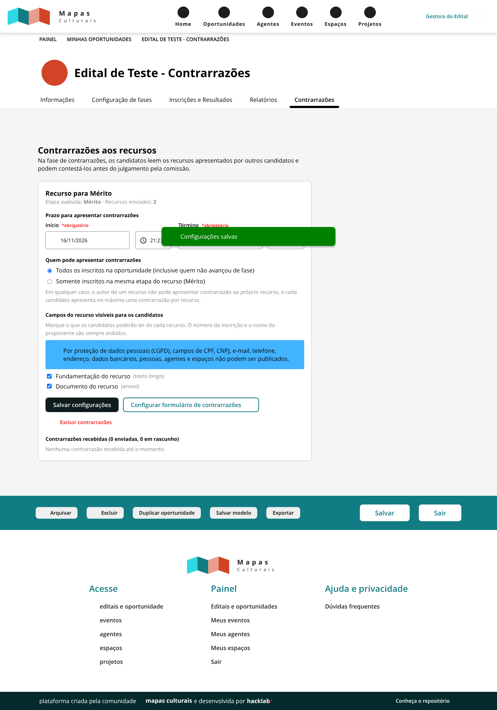
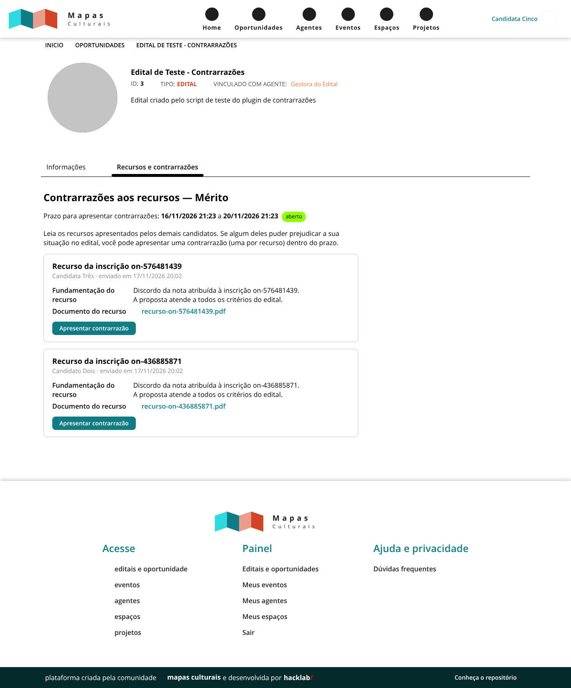

# Plugin de Contrarrazões para o Mapas Culturais

Plugin para o [Mapas Culturais](https://github.com/mapasculturais/mapasculturais) que acrescenta a **fase de contrarrazões** à fase de recurso nativa.

Com o plugin, os candidatos leem os recursos apresentados por outros candidatos e podem contestá-los antes do julgamento. A comissão julga cada recurso já vendo as contrarrazões que ele recebeu.

Desenvolvido para o Mapa Cultural BH (Fundação Municipal de Cultura / PBH).

| Gestor configura | Candidato lê os recursos | Comissão julga |
|---|---|---|
|  |  |  |

## O que o plugin faz

- **Gestor:** a edição da oportunidade ganha a aba **Contrarrazões**. Para cada fase de recurso do edital, o gestor:
  - cria a fase de contrarrazões;
  - define o prazo;
  - escolhe **quem pode apresentar contrarrazões**;
  - escolhe **quais campos do recurso ficam visíveis** para os candidatos;
  - configura o formulário da contrarrazão;
  - acompanha as contrarrazões recebidas.
- **Candidatos:** a página pública do edital ganha a aba **Recursos e contrarrazões**. Ela lista os recursos enviados, com os campos liberados pelo gestor (texto e anexos), e um botão **Apresentar contrarrazão** em cada recurso. O formulário mostra uma faixa com o recurso que está sendo contestado.
- **Comissão:** na tela de avaliação de cada recurso aparece o bloco **Contrarrazões apresentadas a este recurso**, com o conteúdo e os anexos de cada uma.

### Regras

| Regra | Como funciona |
|---|---|
| Quem pode apresentar | Configurável por fase: **todos os inscritos na oportunidade** (inclusive quem foi eliminado em fases anteriores) ou **somente inscritos na mesma etapa do recurso**. A elegibilidade considera inscrições enviadas. |
| Uma por recurso | Cada inscrição pode apresentar no máximo uma contrarrazão por recurso, mas pode contestar vários recursos. Quem tem mais de uma inscrição no edital escolhe com qual vai apresentar. |
| Próprio recurso | O autor não pode apresentar contrarrazão ao próprio recurso. |
| Prazo | Só é possível iniciar uma contrarrazão dentro do prazo. A lista de recursos fica visível a partir do início do prazo. |
| Trava do julgamento | Enquanto o prazo de contrarrazões não terminar, a comissão não consegue finalizar/enviar a avaliação do recurso, e ninguém consegue deferir ou indeferir o recurso. Isso vale também para a decisão pelo chat da avaliação contínua. Sem prazo definido, o julgamento continua travado. Rascunhos de parecer são permitidos. |
| LGPD | Campos de CPF, CNPJ, e-mail, telefone, endereço, dados bancários, pessoas, agentes e espaços **nunca** podem ser publicados. O número da inscrição e o nome do proponente são sempre exibidos. |
| Visibilidade | Só usuários que podem apresentar contrarrazão (e os gestores) veem o conteúdo dos recursos e baixam os anexos públicos. |

## Requisitos

- Mapas Culturais **7.8.x**, com o tema BaseV2. O plugin foi testado na **7.8.22**.
- A fase de recurso nativa (módulo `OpportunityAppealPhase`) já criada na oportunidade.

A versão 7.6.33 não é suportada. Atualize o Mapas antes de instalar.

## Instalação

1. Clone o plugin dentro de `src/plugins`, com o nome de pasta `Contrarrazoes`:

   ```bash
   cd /caminho/do/mapas/src/plugins
   git clone https://github.com/yanlfs08/mapas-plugin-contrarrazoes.git Contrarrazoes
   ```

   Em instalações com Docker, monte a pasta no contêiner, por exemplo:
   `./plugins/Contrarrazoes:/var/www/src/plugins/Contrarrazoes`.

2. Ative o plugin acrescentando `Contrarrazoes` à lista de plugins da sua configuração, sem remover os que já existem:

   ```php
   // config/plugins.php (ou o arquivo de config.d que vocês usam)
   return [
       'plugins' => [
           'MultipleLocalAuth',
           // ... outros plugins já ativos
           'Contrarrazoes',
       ],
   ];
   ```

3. Limpe o cache (Redis ou o cache configurado) e recarregue o PHP-FPM ou o contêiner.

O plugin **não cria tabelas** e não precisa de `db-update`. Ele usa as entidades do próprio Mapas (oportunidade, inscrição e metadados).

### Configurações opcionais

```php
'plugins' => [
    'Contrarrazoes' => [
        'namespace' => 'Contrarrazoes',
        'config' => [
            // trava o julgamento dos recursos até o fim do prazo de contrarrazões (padrão: true)
            'lockAppealJudgement' => true,

            // tipos de campo do recurso que o gestor pode tornar públicos
            'publicFieldTypes' => ['text', 'textarea', 'select', 'checkboxes', 'checkbox', 'number',
                                   'currency', 'date', 'url', 'links', 'custom-table', 'municipio'],

            // título do campo criado automaticamente no formulário de contrarrazões
            'defaultFieldTitle' => 'Fundamentação da contrarrazão',
        ],
    ],
],
```

## Como usar

1. **Crie a fase de recurso** normalmente, em *Configuração de fases*, e deixe os candidatos enviarem os recursos.
2. Na edição da oportunidade, abra a aba **Contrarrazões** e clique em **Adicionar contrarrazões** na fase de recurso desejada.
3. Defina o **prazo** (de preferência começando depois do fim do prazo de recurso), **quem pode apresentar** e os **campos públicos** do recurso. Depois clique em **Salvar configurações**.
4. Se quiser, ajuste o formulário em **Configurar formulário de contrarrazões**. O plugin já cria um campo obrigatório de texto, e você pode acrescentar anexos e outros campos.
5. **Divulgue** a abertura do prazo. Os candidatos acessam a página do edital, aba *Recursos e contrarrazões*.
6. Quando o prazo terminar, a comissão julga os recursos, já com as contrarrazões na tela de avaliação, e o gestor publica o resultado como de costume.

Sugestão de cronograma: resultado preliminar → prazo de recurso → prazo de contrarrazões → julgamento dos recursos → resultado final.

## Modelo de dados

O plugin não cria tabelas. Tudo fica em entidades nativas:

| O quê | Onde fica |
|---|---|
| Fase de contrarrazões | Uma `Opportunity` oculta de primeiro nível (status `-1`, fora das listagens), com os metadados `isCounterAppealPhase`, `counterAppealOf` (id da fase de recurso), `counterAppealEligibility` e `counterAppealPublicFields`. A fase de recurso guarda o vínculo em `counterAppealPhase`. |
| Contrarrazão | Uma `Registration` nessa oportunidade, com os metadados `counterAppealTarget` (id da inscrição de recurso) e `counterAppealAuthorNumber` (número da inscrição do autor no edital). |

- Excluir a fase de contrarrazões (aba *Contrarrazões*) apaga definitivamente as contrarrazões recebidas.
- Excluir a fase de recurso também exclui a fase de contrarrazões.
- Se a fase de recurso for para a lixeira, as contrarrazões ficam inativas, mas não são apagadas.

## Atualizações do Mapas

O plugin fica fora do código do Mapas. Atualizar o Mapas não sobrescreve o plugin, e o plugin **não precisa ser atualizado a cada versão**: só quando o Mapas muda algo de que ele depende.

- **Dependências de baixo risco:** entidades, metadados, hooks de permissão e de controlador.
- **Dependências de risco médio:** os pontos de encaixe nas telas (`template(opportunity.edit.tabs)`, `template(opportunity.single.tabs)`, `template(registration.evaluation.registration-appealPhase-evaluation-view)`, `main-header`) e os detalhes do módulo de recurso.

Na inicialização, o plugin registra um aviso no log quando a versão do Mapas está fora da faixa testada (7.8.x).

Rotina sugerida a cada atualização:

1. Use sempre tags de versão do Mapas, nunca o `develop`.
2. Leia o `CHANGELOG.md` do Mapas procurando mudanças em `OpportunityAppealPhase` e `OpportunityPhases`.
3. Atualize primeiro o servidor de desenvolvimento e rode os testes da pasta `tests/`.
4. Só depois atualize a produção.

## Testes

Os testes rodam contra um Mapas de **desenvolvimento** com o provedor de login `Fake`. Nunca rode em produção: eles criam usuários, editais e inscrições.

```bash
# na raiz do Mapas, com as mesmas variáveis de ambiente do servidor
php src/plugins/Contrarrazoes/tests/seed-scenario.php base
# crie a fase de recurso do "Mérito" (pela interface ou pelo endpoint createAppealPhase),
# peça os recursos de C2 e C3 (createAppealPhaseRegistration) e então:
php src/plugins/Contrarrazoes/tests/seed-scenario.php appeals <id da fase de recurso>
php src/plugins/Contrarrazoes/tests/seed-scenario.php committee <id da fase de recurso>

# monte o tests/scenario.json com os ids gerados (veja tests/scenario.example.json)
pip install requests playwright
MAPAS_URL=http://localhost:8080 python3 tests/api_test.py tests/scenario.json   # 39 verificações de API e regras
MAPAS_URL=http://localhost:8080 python3 tests/e2e_test.py tests/scenario.json /tmp/capturas  # fluxo completo no navegador
```

Os dois roteiros alteram o banco: restaure o estado do cenário antes de rodar de novo.

## Limitações conhecidas

- O plugin **não envia e-mails** de abertura do prazo nem de contrarrazão recebida. A divulgação é feita pelos canais do edital.
- As contrarrazões em si não passam por avaliação no plugin. Elas servem de subsídio ao julgamento do recurso. A inscrição de contrarrazão pode ser aberta pelo gestor, como qualquer inscrição.
- O formulário de contrarrazão não tem ponto de encaixe para mostrar o conteúdo do recurso. Por isso o plugin usa uma faixa no topo da página, com o link para a lista de recursos.

## Desinstalação

1. Remova `Contrarrazoes` da lista de plugins e limpe o cache. As telas voltam ao padrão.
2. Os dados (fases ocultas e contrarrazões) permanecem no banco e voltam a aparecer se o plugin for reativado.
