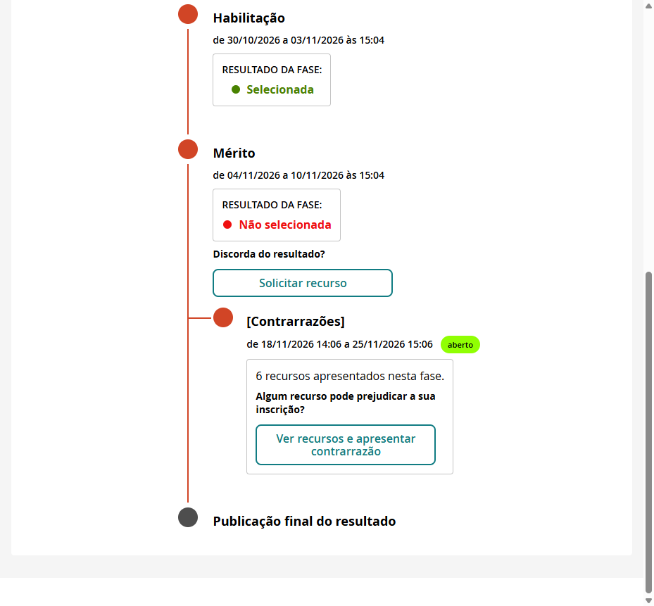
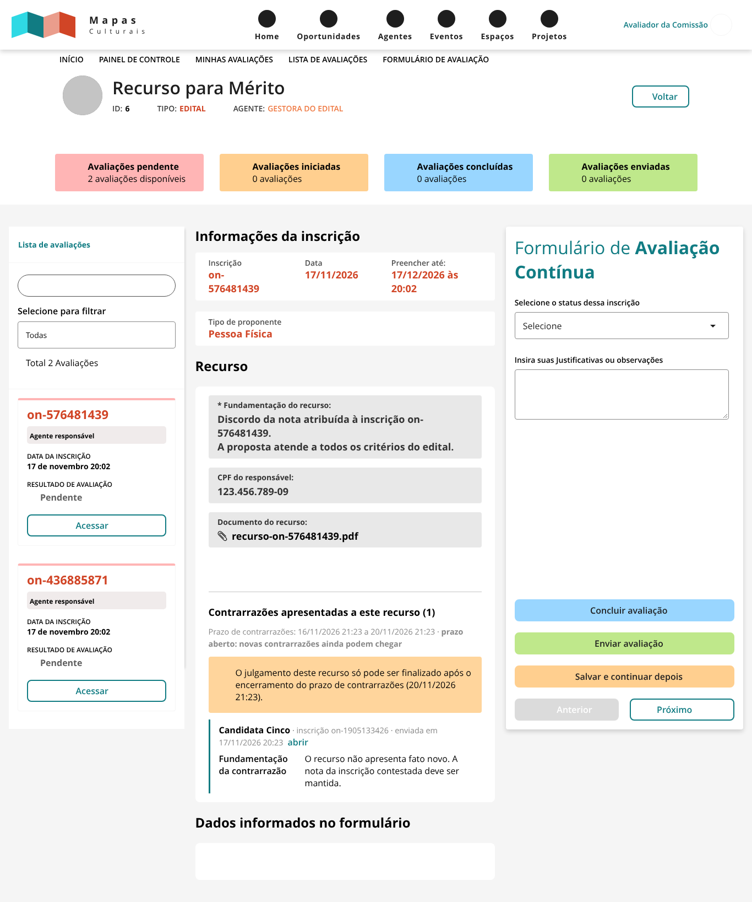
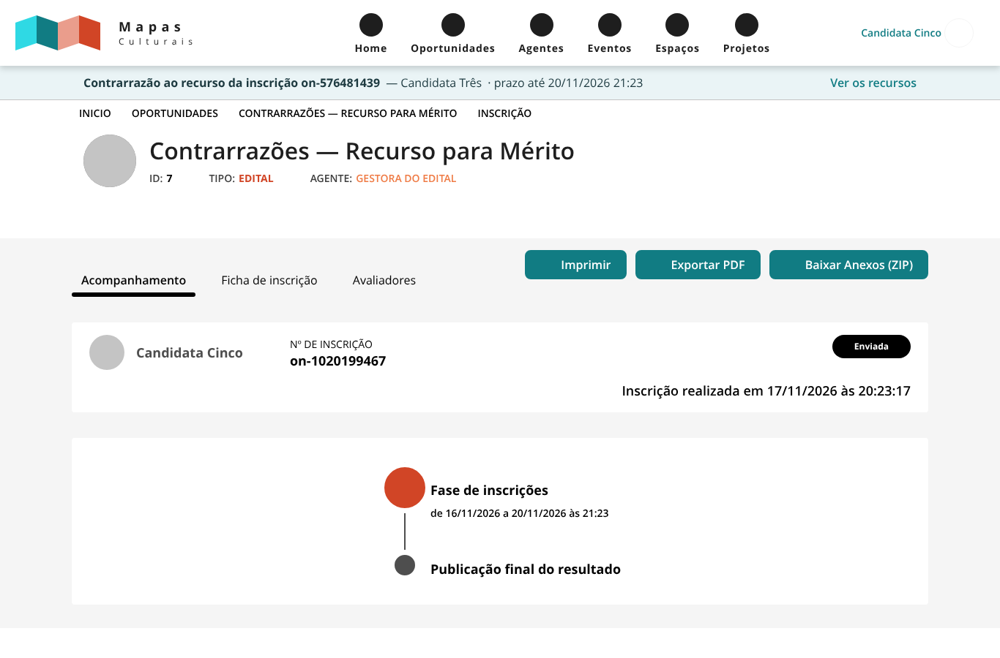

# Plugin de Contrarrazões para o Mapas Culturais

Plugin para o [Mapas Culturais](https://github.com/mapasculturais/mapasculturais) que acrescenta uma **fase de contrarrazões** à fase de recurso nativa.

Com o plugin, os candidatos que estão na etapa avaliada leem os recursos apresentados pelos colegas e podem contestá-los antes do julgamento. A comissão julga cada recurso já vendo as contrarrazões que ele recebeu.

Desenvolvido para o Mapa Cultural BH (Fundação Municipal de Cultura / PBH).

| Gestor configura | Candidato vê na linha do tempo | Candidato lê os recursos | Comissão julga |
|---|---|---|---|
|  |  |  |  |

## Sumário

1. [O que o plugin faz](#o-que-o-plugin-faz)
2. [Regras](#regras)
3. [Requisitos](#requisitos)
4. [Instalação](#instalação)
   - [Instalação direta (sem Docker)](#a-instalação-direta-sem-docker)
   - [Instalação com Docker (projeto base do Mapas)](#b-instalação-com-docker-projeto-base-do-mapas)
   - [Conferindo se o plugin está ativo](#conferindo-se-o-plugin-está-ativo)
   - [Configurações opcionais](#configurações-opcionais)
   - [Atualizando o plugin](#atualizando-o-plugin)
   - [Problemas comuns](#problemas-comuns)
5. [Como usar](#como-usar)
6. [Modelo de dados](#modelo-de-dados)
7. [Referência técnica](#referência-técnica)
   - [Estrutura de arquivos](#estrutura-de-arquivos)
   - [Metadados registrados](#metadados-registrados)
   - [Endpoints](#endpoints)
   - [Pontos de encaixe nas telas](#pontos-de-encaixe-nas-telas)
   - [Hooks de permissão e de trava](#hooks-de-permissão-e-de-trava)
   - [Funções da classe `Plugin`](#funções-da-classe-plugin)
   - [Componentes Vue](#componentes-vue)
8. [Atualizações do Mapas](#atualizações-do-mapas)
9. [Testes](#testes)
10. [Limitações conhecidas](#limitações-conhecidas)
11. [Desinstalação](#desinstalação)

## O que o plugin faz

**Gestor.** Na edição da oportunidade, aba **Configuração de fases**, a *Etapa de recurso* de cada fase avaliada ganha o acordeão **Contrarrazões**, entre os acordeões **Recurso** e **Resposta do recurso**. Nele, o gestor:

- cria a fase de contrarrazões (botão **Adicionar contrarrazões**);
- define o prazo (início e término);
- escolhe **quais campos do recurso ficam visíveis** para os candidatos;
- configura o formulário da contrarrazão (botão **Configurar formulário**);
- define a **classificação da resposta** às contrarrazões (padrão: *Acolhida*, *Parcialmente acolhida*, *Não acolhida*; pode trocar as opções ou deixar a resposta só em texto);
- acompanha as contrarrazões recebidas e as respostas da comissão, numa tabela;
- exclui a fase de contrarrazões, se precisar.


**Candidato.** Na linha do tempo da inscrição (*Minhas inscrições* → inscrição → aba *Acompanhamento*), a fase que recebeu recurso ganha o bloco **[Contrarrazões]**, logo abaixo do botão **Solicitar recurso** (ou do quadro *[Recurso]*, se o candidato já recorreu). O bloco mostra:

- o prazo, com o selo *aberto* ou *encerrado*;
- quantos recursos foram apresentados e quantas contrarrazões a inscrição já enviou;
- um aviso quando há contrarrazão iniciada e ainda não enviada;
- o botão **Ver recursos e apresentar contrarrazão**, que abre um modal com a lista de recursos.

No modal, cada recurso mostra o número da inscrição, o nome do proponente, os campos liberados pelo gestor (texto e anexos para baixar) e o botão **Apresentar contrarrazão**. Depois de enviada, o botão vira **Ver contrarrazão enviada**. O recurso do próprio candidato aparece marcado como **Seu recurso**, sem botão.

A contrarrazão fica vinculada à inscrição da página. Quem tem mais de uma inscrição no edital usa a linha do tempo da inscrição com a qual quer contestar.

O formulário da contrarrazão mostra uma faixa no topo com o recurso contestado, o prazo e o link **Ver os recursos**, que volta para a linha do tempo com o modal aberto.



**Comissão.** Na tela de avaliação de cada recurso aparece o bloco **Contrarrazões apresentadas a este recurso**, com o conteúdo e os anexos de cada contrarrazão e o aviso da trava do julgamento enquanto o prazo estiver aberto.

Depois do fim do prazo de contrarrazões, o **avaliador do recurso responde a cada contrarrazão** ali mesmo: escolhe a classificação (se a fase tiver) e escreve a fundamentação. Cada contrarrazão mostra o selo *Pendente* ou *Respondida*, e o título mostra quantas já foram respondidas. A resposta pode ser editada até o avaliador finalizar a avaliação do recurso.

**Resposta publicada.** Quando o gestor publica o resultado da etapa de recurso, a resposta aparece para:

- o **autor da contrarrazão**, na faixa da página da contrarrazão e no modal de recursos da linha do tempo;
- o **autor do recurso**, no modal de recursos da linha do tempo, junto do *Seu recurso* (com o nome e o número da inscrição de quem contestou).

A resposta é assinada como "comissão": o nome do avaliador não aparece para os candidatos.

## Regras

| Regra | Como funciona |
|---|---|
| Quem pode apresentar | Somente inscrições **enviadas** que estão na **mesma etapa do recurso**, ou seja, na fase avaliada que recebeu o recurso (por exemplo, o *Mérito*). Quem foi eliminado antes dessa etapa não vê o bloco nem os recursos. Não é configurável. |
| Uma por recurso | Cada inscrição apresenta no máximo uma contrarrazão por recurso. Pode contestar vários recursos. |
| Próprio recurso | O autor não contesta o próprio recurso. Os recursos de qualquer inscrição do mesmo usuário aparecem como *Seu recurso*. |
| Prazo | Uma contrarrazão só pode ser iniciada dentro do prazo. A lista de recursos aparece a partir do início do prazo. Contrarrazão já iniciada continua acessível depois do prazo, para consulta. |
| Trava do julgamento | Enquanto o prazo de contrarrazões não terminar, a comissão não finaliza nem envia a avaliação do recurso, e ninguém defere ou indefere o recurso, nem pela mudança de status nem pelo chat da avaliação contínua. Sem prazo definido, o julgamento continua travado. Rascunhos de parecer são permitidos. |
| Resposta às contrarrazões | Só o **avaliador designado para o recurso** responde, depois do fim do prazo de contrarrazões. A resposta é **obrigatória**: o avaliador não finaliza a avaliação, ninguém defere ou indefere o recurso (status, chat ou aplicação em lote) e o resultado da etapa de recurso não é publicado enquanto houver contrarrazão enviada sem resposta. Com mais de um avaliador por recurso, cada um responde dentro da própria avaliação. A resposta fica travada depois que o avaliador finaliza a avaliação ou que o resultado é publicado. |
| Publicidade da resposta | Os candidatos só veem a resposta depois da **publicação do resultado da etapa de recurso**: o autor da contrarrazão e o autor do recurso contestado. Os demais inscritos não veem. |
| LGPD | Campos de CPF, CNPJ, e-mail, telefone, endereço, dados bancários, pessoas, agentes e espaços **nunca** podem ser publicados. O número da inscrição e o nome do proponente são sempre exibidos. |
| Visibilidade | Só quem pode apresentar contrarrazão (e os gestores) vê o conteúdo dos recursos e baixa os anexos públicos. A página pública do edital não mostra a lista. |

## Requisitos

- Mapas Culturais **7.8.x**, com o tema **BaseV2**. Testado na **7.8.21** e na **7.8.22**. A 7.6.x não é suportada.
- O módulo nativo de recurso (`OpportunityAppealPhase`), com a fase de recurso criada na oportunidade.
- Acesso para editar a configuração do Mapas e reiniciar o PHP (ou os contêineres).

O plugin **não cria tabelas** e **não precisa de `db-update`**. Ele usa as entidades do próprio Mapas (oportunidade, inscrição e metadados).

## Instalação

O plugin precisa ficar na pasta `src/plugins/Contrarrazoes` do Mapas. O nome da pasta tem que ser exatamente `Contrarrazoes`, porque é também o namespace PHP do plugin.

### A) Instalação direta (sem Docker)

1. **Baixe o plugin** para a pasta de plugins do Mapas:

   ```bash
   cd /caminho/do/mapas/src/plugins
   git clone https://github.com/yanlfs08/mapas-plugin-contrarrazoes.git Contrarrazoes
   ```

2. **Ative o plugin** na configuração. Abra o arquivo de configuração de plugins que a sua instalação usa (por exemplo, `config/plugins.php` ou um arquivo dentro de `config/*.d/`) e acrescente `Contrarrazoes` à lista, **sem remover os plugins que já existem**:

   ```php
   <?php
   return [
       'plugins' => [
           'MultipleLocalAuth' => ['namespace' => 'MultipleLocalAuth'],
           // ... outros plugins já ativos
           'Contrarrazoes' => ['namespace' => 'Contrarrazoes'],
       ],
   ];
   ```

3. **Recompile os assets**, se a sua instalação compila os componentes com `pnpm`:

   ```bash
   cd /caminho/do/mapas/src
   pnpm install --recursive && pnpm run build
   ```

4. **Limpe o cache e reinicie o PHP:**

   ```bash
   redis-cli FLUSHALL                  # se o cache do Mapas estiver no Redis
   sudo systemctl reload php8.3-fpm    # ajuste para a versão do seu PHP-FPM
   ```

5. [Confira se o plugin está ativo](#conferindo-se-o-plugin-está-ativo).

### B) Instalação com Docker (projeto base do Mapas)

No [projeto base do Mapas](https://github.com/mapasculturais/mapasculturais-base-project), a imagem é gerada a partir de `docker/Dockerfile`, que **copia** a pasta `plugins/` e a configuração para dentro da imagem:

```dockerfile
FROM hacklab/mapasculturais:latest

COPY themes /var/www/src/themes
COPY plugins /var/www/src/plugins

WORKDIR /var/www/src
RUN pnpm install --recursive && pnpm run build
WORKDIR /var/www

COPY docker/common/config.d /var/www/config/common.d
COPY docker/production/config.d /var/www/config/config.d
```

Por isso, toda instalação ou atualização do plugin exige **gerar a imagem de novo**.

1. **Baixe o plugin** para a pasta `plugins/` do projeto:

   ```bash
   cd /caminho/do/projeto-base/plugins
   git clone https://github.com/yanlfs08/mapas-plugin-contrarrazoes.git Contrarrazoes
   ```

2. **Ative o plugin** em `docker/common/config.d/plugins.php`:

   ```php
   <?php
   return [
       'plugins' => [
           'MultipleLocalAuth' => ['namespace' => 'MultipleLocalAuth'],
           'SamplePlugin' => ['namespace' => 'SamplePlugin'],
           'SpamDetector',
           'Contrarrazoes' => ['namespace' => 'Contrarrazoes'],
       ],
   ];
   ```

3. **Confira o `docker/Dockerfile`.** As linhas `COPY plugins ...` e `COPY docker/common/config.d ...` precisam estar presentes e sem caracteres soltos (um `'` perdido no começo de uma linha quebra o build).

4. **Gere a imagem e recrie o contêiner da aplicação:**

   ```bash
   cd /caminho/do/projeto-base
   docker compose build mapasculturais
   docker compose up -d mapasculturais
   ```

5. **Limpe o cache** (o Redis de cache do projeto base se chama `redis`):

   ```bash
   docker compose exec redis redis-cli FLUSHALL
   ```

6. [Confira se o plugin está ativo](#conferindo-se-o-plugin-está-ativo).

> **Alternativa para desenvolvimento:** em vez de gerar a imagem a cada mudança, monte a pasta do plugin como volume no serviço `mapasculturais` do `docker-compose.yml`:
>
> ```yaml
>     volumes:
>       - ./plugins/Contrarrazoes:/var/www/src/plugins/Contrarrazoes
> ```
>
> Com o volume, mudanças em PHP valem depois de limpar o cache. Mudanças em JavaScript ou CSS dos componentes exigem recompilar os assets dentro do contêiner (`pnpm run build` em `/var/www/src`).

### Conferindo se o plugin está ativo

1. **Arquivos no lugar** (no Docker, dentro do contêiner):

   ```bash
   docker compose exec mapasculturais ls /var/www/src/plugins
   # deve listar: Contrarrazoes
   docker compose exec mapasculturais grep Contrarrazoes /var/www/config/common.d/plugins.php
   ```

2. **Metadados registrados.** A API de descrição das oportunidades passa a listar os campos do plugin:

   ```bash
   curl -s http://localhost/api/opportunity/describe | grep -o 'counterAppeal[A-Za-z]*' | sort -u
   # counterAppealEligibility, counterAppealOf, counterAppealPhase, counterAppealPublicFields
   ```

3. **Log sem erros.** No projeto base, o log da aplicação fica em `docker-data/logs/app.log`. Se a versão do Mapas estiver fora da faixa testada, aparece o aviso *"Plugin Contrarrazoes ... foi testado com o Mapas Culturais 7.8.x"*.

4. **Na tela:** abra uma oportunidade que tenha fase de recurso, aba **Configuração de fases**, expanda a fase avaliada e confira o acordeão **Contrarrazões** entre *Recurso* e *Resposta do recurso*.

### Configurações opcionais

Para mudar o comportamento padrão, informe `config` na ativação do plugin:

```php
'plugins' => [
    'Contrarrazoes' => [
        'namespace' => 'Contrarrazoes',
        'config' => [
            // trava o julgamento dos recursos até o fim do prazo de contrarrazões (padrão: true)
            'lockAppealJudgement' => true,

            // tipos de campo do recurso que o gestor pode tornar públicos
            'publicFieldTypes' => ['text', 'textarea', 'select', 'checkboxes', 'checkbox', 'number',
                                   'currency', 'date', 'url', 'links', 'custom-table', 'municipio'],

            // título do campo criado automaticamente no formulário de contrarrazões
            'defaultFieldTitle' => 'Fundamentação da contrarrazão',

            // a resposta às contrarrazões é obrigatória para finalizar o recurso (padrão: true)
            'requireCounterAppealResponse' => true,

            // classificação padrão das fases novas (o gestor pode trocar em cada fase)
            'defaultResponseResults' => ['Acolhida', 'Parcialmente acolhida', 'Não acolhida'],

            // tamanho máximo do texto da resposta
            'responseMaxLength' => 20000,
        ],
    ],
],
```

| Chave | Padrão | Efeito |
|---|---|---|
| `lockAppealJudgement` | `true` | Com `false`, a comissão pode julgar os recursos mesmo com o prazo de contrarrazões aberto. |
| `publicFieldTypes` | lista acima | Tipos de campo do formulário de recurso que aparecem como opção de publicação. Não acrescente tipos com dados pessoais. |
| `defaultFieldTitle` | *Fundamentação da contrarrazão* | Título do campo de texto obrigatório criado com a fase. |
| `requireCounterAppealResponse` | `true` | Com `false`, a resposta continua disponível, mas deixa de ser exigida para finalizar o recurso. |
| `defaultResponseResults` | *Acolhida*, *Parcialmente acolhida*, *Não acolhida* | Opções de classificação usadas enquanto o gestor não personalizar a fase. |
| `responseMaxLength` | `20000` | Número máximo de caracteres da fundamentação da resposta. |

### Atualizando o plugin

```bash
cd /caminho/para/plugins/Contrarrazoes
git pull
```

Depois repita o passo de reiniciar. Na **instalação direta**, recompile os assets e recarregue o PHP. No **Docker**, rode `docker compose build mapasculturais && docker compose up -d mapasculturais`. Nos dois casos, limpe o cache. Leia o `CHANGELOG.md` antes de atualizar.

### Problemas comuns

| Sintoma | Causa provável e solução |
|---|---|
| O acordeão *Contrarrazões* não aparece | Plugin não ativado ou imagem antiga. Confira os passos de ativação e reinício. No Docker, o `git pull` sozinho não muda nada: é preciso gerar a imagem de novo. |
| O acordeão aparece no fim da *Etapa de recurso*, e não entre *Recurso* e *Resposta do recurso* | Uma atualização do Mapas mudou a marcação do componente de recurso. O plugin continua funcionando e registra um aviso no log. Veja [Atualizações do Mapas](#atualizações-do-mapas). |
| O candidato não vê o bloco *[Contrarrazões]* | A inscrição não está na etapa do recurso (foi eliminada antes), o prazo ainda não começou, ou a fase de contrarrazões não foi criada. |
| O candidato é levado para a edição do perfil | Comportamento do Mapas: perfil incompleto (descrição curta, área de atuação) redireciona para a edição. Não é do plugin. |
| A comissão não consegue enviar a avaliação do recurso | É a trava do julgamento: o prazo de contrarrazões ainda não terminou ou não foi definido. |
| Mudanças de configuração demoram a valer | Limpe o cache (Redis). |

## Como usar

1. **Crie a fase de recurso** normalmente, em *Configuração de fases*, e deixe os candidatos enviarem os recursos.
2. Na mesma aba, expanda a fase que tem recurso. Na *Etapa de recurso*, abra o acordeão **Contrarrazões** e clique em **Adicionar contrarrazões**.
3. Defina o **prazo** (de preferência começando depois do fim do prazo de recurso e terminando antes da resposta do recurso) e marque os **campos do recurso visíveis**. Clique em **Salvar configurações**.
4. Se quiser, ajuste o formulário em **Configurar formulário**. O plugin já cria um campo obrigatório de texto, e você pode acrescentar anexos e outros campos.
5. **Divulgue** a abertura do prazo. Os candidatos acessam a própria inscrição (*Minhas inscrições*) e usam o bloco *[Contrarrazões]* na linha do tempo.
6. Quando o prazo terminar, o avaliador de cada recurso **responde às contrarrazões** na tela de avaliação e só então finaliza o julgamento do recurso.
7. O gestor publica o resultado da etapa de recurso como de costume. A partir daí, os autores das contrarrazões e dos recursos contestados veem as respostas.

Sugestão de cronograma: resultado preliminar → prazo de recurso → prazo de contrarrazões → julgamento dos recursos e resposta às contrarrazões → resultado final.

## Modelo de dados

O plugin não cria tabelas. Tudo fica em entidades nativas do Mapas:

| O quê | Onde fica |
|---|---|
| Fase de contrarrazões | Uma `Opportunity` **oculta de primeiro nível** (sem `parent`, status `-1`, fora das listagens), com os metadados `isCounterAppealPhase`, `counterAppealOf` e `counterAppealPublicFields`. A fase de recurso guarda o vínculo em `counterAppealPhase`. |
| Contrarrazão | Uma `Registration` nessa oportunidade, com os metadados `counterAppealTarget` (id da inscrição de recurso contestada) e `counterAppealAuthorNumber` (número da inscrição autora no edital). |
| Resposta à contrarrazão | No metadado **privado** `counterAppealResponses` da fase de contrarrazões, no formato `{id da contrarrazão: {id do avaliador: {result, text, created, updated}}}`. As opções de classificação ficam em `counterAppealResponseResults`. |

Por que a resposta fica **na fase**, e não na contrarrazão: o dono de uma inscrição lê todos os metadados privados dela (inclusive pela API). Gravada na contrarrazão, a resposta chegaria ao candidato antes da publicação. Na fase oculta, só os gestores leem o metadado, e o plugin entrega a resposta aos candidatos apenas depois da publicação. A gravação é feita sob trava (`App::lock`), relendo o valor do banco, para que dois avaliadores respondendo ao mesmo tempo não se sobrescrevam.

Por que **primeiro nível**: a página da inscrição (`registration/single.php`) usa `$entity->firstPhase`. Se a fase de contrarrazões fosse filha da fase de recurso, a página da contrarrazão quebraria.

Por que **status `-1`**: o Mapas só permite ver e enviar inscrições em oportunidades com status `-1`, `1` ou `-20`. O `-20` dispara a lógica nativa de recurso, e o `1` faria a fase aparecer nas buscas.

- Excluir a fase de contrarrazões (acordeão *Contrarrazões*) apaga **definitivamente** as contrarrazões recebidas.
- Excluir a fase de recurso também exclui a fase de contrarrazões.
- Se a fase de recurso for para a lixeira, as contrarrazões ficam inativas, mas não são apagadas.

## Referência técnica

Esta seção explica cada peça do plugin. Toda a lógica está em `Plugin.php`. As telas usam componentes Vue no padrão do tema BaseV2.

### Estrutura de arquivos

```
Contrarrazoes/
├── Plugin.php                                  toda a lógica (metadados, permissões, endpoints, trava, telas)
├── assets/css/contrarrazoes.css                estilos dos componentes
├── components/
│   ├── counter-appeal-config/                  acordeão "Contrarrazões" do gestor
│   │   ├── template.php
│   │   ├── script.js
│   │   └── texts.php
│   ├── counter-appeal-timeline/                bloco "[Contrarrazões]" na linha do tempo do candidato
│   │   ├── template.php
│   │   └── script.js
│   ├── counter-appeal-list/                    lista de recursos (dentro do modal)
│   │   ├── template.php
│   │   ├── script.js
│   │   └── texts.php
│   └── counter-appeal-evaluation/              bloco da comissão na avaliação do recurso
│       ├── template.php
│       └── script.js
├── layouts/parts/contrarrazoes/
│   ├── evaluation-block.php                    encaixa counter-appeal-evaluation na tela da comissão
│   └── registration-banner.php                 faixa com o recurso contestado no formulário da contrarrazão
├── tests/                                      cenário e testes (API e navegador)
├── docs/capturas/                              imagens deste README
├── CHANGELOG.md
└── CLAUDE.md                                   contexto e armadilhas para manutenção
```

### Metadados registrados

Registrados em `Plugin::register()`.

| Entidade | Metadado | Tipo | Para que serve |
|---|---|---|---|
| Opportunity | `isCounterAppealPhase` | boolean | Marca a oportunidade oculta como fase de contrarrazões. |
| Opportunity | `counterAppealOf` | integer | Na fase de contrarrazões: id da fase de recurso a que ela pertence. |
| Opportunity | `counterAppealPhase` | integer | Na fase de recurso: id da fase de contrarrazões ligada a ela. |
| Opportunity | `counterAppealPublicFields` | json | Nomes dos campos do recurso que os candidatos podem ler (`field_N` e grupos de anexo `rfc_N`). |
| Opportunity | `counterAppealResponseResults` | json | Na fase de contrarrazões: opções de classificação da resposta. `null` = padrão do plugin; `[]` = resposta só em texto. |
| Opportunity | `counterAppealResponses` | json (privado) | Na fase de contrarrazões: respostas dos avaliadores, por contrarrazão e por avaliador. Só é gravado pelo endpoint `saveCounterAppealResponse`. |
| Opportunity | `counterAppealEligibility` | select | **Obsoleto desde a 1.1.0.** Continua registrado para não quebrar fases antigas, mas é ignorado: a regra é sempre a mesma etapa do recurso. |
| Registration | `counterAppealTarget` | integer | Na contrarrazão: id da inscrição de recurso contestada. |
| Registration | `counterAppealAuthorNumber` | string | Na contrarrazão: número da inscrição autora no edital (permite uma contrarrazão por recurso **por inscrição**). |

### Endpoints

Todos são ações nos controladores existentes do Mapas (hooks `POST(...)` e `GET(...)`). No JavaScript, use `entity.invoke(acao, dados)`. Todos exigem login.

| Endpoint | Quem pode | O que faz |
|---|---|---|
| `POST /opportunity/createCounterAppealPhase/{id da fase de recurso}` | gestor (`@control` na fase de recurso) | Cria a fase de contrarrazões com o formulário padrão. Se já existir, devolve a existente. Resposta: a fase serializada. |
| `POST /opportunity/saveCounterAppealConfig/{id da fase de contrarrazões}` | gestor | Salva `registrationFrom`, `registrationTo`, `counterAppealPublicFields` e a classificação da resposta (`counterAppealResponseClassify` e `counterAppealResponseResults`; ligada sem opções responde 400). Valida as datas (o término não pode ser anterior ao início) e descarta campos que não podem ser publicados. Ignora `counterAppealEligibility`. Limpa o cache de permissões. |
| `POST /opportunity/deleteCounterAppealPhase/{id}` | gestor | Desfaz o vínculo com a fase de recurso e exclui definitivamente a fase e as contrarrazões. |
| `GET /opportunity/counterAppealFile/{id da fase}/file:{id do arquivo}` | gestor ou inscrito na etapa | Baixa um anexo de recurso marcado como público, depois do início do prazo. Qualquer outro caso responde 403. |
| `POST /registration/saveCounterAppealResponse/{id da contrarrazão}` | avaliador do recurso contestado | Dados: `result` (uma das opções da fase, quando houver classificação) e `text`. Só depois do fim do prazo de contrarrazões, antes de o avaliador finalizar a avaliação e antes da publicação do resultado. Resposta: a resposta gravada e quantas contrarrazões ainda estão pendentes para esse avaliador. |
| `POST /opportunity/createCounterAppealRegistration/{id da fase}` | inscrito na etapa | Dados: `appeal_registration_id` e `author_registration_id`. Valida as regras, devolve a contrarrazão existente daquela inscrição para aquele recurso ou, dentro do prazo, cria uma nova (rascunho). |

### Pontos de encaixe nas telas

Registrados em `Plugin::initTemplateHooks()` e em `_init()`.

| Hook | O que faz |
|---|---|
| `template(opportunity.edit.tabs):end` | Na edição da oportunidade, monta `$MAPAS.config.counterAppealConfig` (uma entrada por fase de recurso, com a fase de contrarrazões, os campos publicáveis e as contrarrazões recebidas) e importa `counter-appeal-config`. Não imprime nada. |
| `mapas.printJsObject:after` (prioridade 5) | Insere `<counter-appeal-config>` no template do componente nativo `opportunity-appeal-phase-config`, entre os acordeões *Recurso* e *Resposta do recurso*, antes de os templates irem para a página. O componente nativo não tem ponto de encaixe ali, e o plugin **não copia** o template do núcleo. Veja `injectCounterAppealConfig()`. |
| `template(registration.<<view\|single>>.single-tab):begin` | Na página da inscrição, só para o dono, monta `$MAPAS.config.counterAppealList` com os dados das fases de contrarrazões para **essa** inscrição. Não imprime nada. |
| `component(opportunity-phases-timeline).item:end` | Coloca `<counter-appeal-timeline>` no fim de cada item da linha do tempo. O componente só se mostra no item da fase avaliada que recebeu recurso. Mesmo padrão do módulo nativo `OpportunityExecution`. |
| `template(registration.<<view\|edit\|single>>.main-header):after` | No formulário e na ficha de uma contrarrazão, mostra a faixa `registration-banner.php` com o recurso contestado, o prazo e o link de volta para a lista. |
| `template(registration.evaluation.registration-appealPhase-evaluation-view):after` | Na avaliação do recurso, monta `$MAPAS.config.counterAppealEvaluation` (contrarrazões enviadas, prazo, trava, respostas do avaliador da avaliação aberta, opções de classificação e se ele pode responder) e mostra `counter-appeal-evaluation`. Quando o gestor abre a avaliação de outro avaliador (`?user=`), as respostas aparecem só para leitura. |
| `GET(opportunity.<<single\|edit>>):before` | A fase de contrarrazões não tem página própria. Quem abre o endereço dela vai para a *Configuração de fases* (gestor), para a linha do tempo da inscrição com a lista aberta (candidato na etapa) ou para a página do edital (demais). |
| `app.init:after` | Carrega `assets/css/contrarrazoes.css`. |

### Hooks de permissão e de trava

Registrados em `initPermissionHooks()`, `initJudgementLockHooks()` e `_init()`.

| Hook | O que faz |
|---|---|
| `can(Opportunity.<<@control\|modify\|view\|...>>)` | Quem controla a fase de recurso controla a fase de contrarrazões. |
| `entity(Opportunity).permissionCacheUsers` | Inclui os gestores do edital no cache de permissões da fase de contrarrazões. |
| `entity(Registration).<<insert\|send>>:before` | Impede criar ou enviar uma inscrição na fase de contrarrazões sem `counterAppealTarget`, ou seja, fora do endpoint `createCounterAppealRegistration`. |
| `can(Registration.<<view\|viewPrivateData\|viewPrivateFiles\|viewConsolidatedResult>>)` | Gestores do edital e quem pode ver o recurso contestado (a comissão) podem ver a contrarrazão e seus anexos. |
| `POST(registration.<<saveEvaluation\|saveEvaluationAndChangeStatus\|sendEvaluation>>):before` | Trava: bloqueia finalizar ou enviar a avaliação do recurso dentro do prazo. Rascunhos passam. |
| `entity(RegistrationEvaluation).save:before` | Trava: proteção extra para qualquer outro caminho que grave uma avaliação finalizada. Libera a trava de gravação do Mapas antes de recusar. |
| `entity(ChatMessage).insert:before` | Trava: impede decidir o recurso pelo chat da avaliação contínua. |
| `entity(Registration).save:before` | Trava: impede mudar o status do recurso (deferir ou indeferir) dentro do prazo. O envio do recurso pelo candidato (rascunho → enviado) continua permitido. Também impede deferir, indeferir, invalidar ou pôr em suplência um recurso com contrarrazão enviada sem resposta. |
| `POST(registration.<<saveEvaluation\|...>>):before`, `entity(RegistrationEvaluation).save:before`, `entity(ChatMessage).insert:before` | Resposta obrigatória: além da trava, recusam a finalização (ou a decisão pelo chat) enquanto o avaliador não responder a todas as contrarrazões enviadas ao recurso. |
| `POST(opportunity.applyEvaluationsContinuous):before` | Antes da aplicação em lote dos resultados da avaliação contínua, recusa com a lista dos recursos travados ou com contrarrazão sem resposta. Assim o lote não é aplicado pela metade. |
| `ALL(opportunity.publishRegistrations):before` | Recusa a publicação do resultado da etapa de recurso durante o prazo de contrarrazões ou com contrarrazão sem resposta. |
| `PATCH(opportunity.single):before` e `PUT(opportunity.single):before` | Recusa gravar `counterAppealResponses` pela API comum da oportunidade. |
| `entity(Opportunity).destroy:before` | Ao excluir a fase de recurso, agenda a exclusão da fase de contrarrazões para o fim da requisição. |

As regras que dependem de data (prazo e trava) **não** ficam em hooks `can(...)`, porque o Mapas guarda o resultado desses hooks em cache por até um dia.

### Funções da classe `Plugin`

**Configuração e inicialização**

| Função | O que faz |
|---|---|
| `__construct(array $config)` | Aplica os valores padrão de `publicFieldTypes`, `lockAppealJudgement` e `defaultFieldTitle`. |
| `_init()` | Verifica a versão do Mapas, carrega o CSS e registra os hooks (permissões, endpoints, trava, telas), o redirecionamento da URL da fase e a exclusão em cascata. |
| `register()` | Registra os metadados da tabela [Metadados registrados](#metadados-registrados). |
| `checkMapasVersion()` | Lê o `version.txt` do Mapas e grava um aviso no log se a versão não for 7.8.x. |

**Consultas**

| Função | O que faz |
|---|---|
| `meta($entity, $key)` (estática) | Lê um metadado sem passar pela checagem de dados privados. Dentro de hooks `can(...)`, ler `$entity->chave` causaria recursão infinita. |
| `getCounterAppealPhase($appeal_phase)` | Fase de contrarrazões de uma fase de recurso, ou `null`. |
| `getAppealPhase($counter)` | Fase de recurso de uma fase de contrarrazões, ou `null` se ela estiver na lixeira ou não existir. |
| `getAppealPhasesOfOpportunity($opportunity)` | Todas as fases de recurso do edital, na ordem das fases. |
| `getEligibilityBasePhase($counter)` | Fase que define quem pode contestar: sempre a fase avaliada que recebeu o recurso. |
| `getUserCandidateRegistrations($counter, $user)` | Inscrições **enviadas** do usuário nessa fase avaliada. São as inscrições que podem apresentar contrarrazão. |
| `getSentAppeals($appeal_phase)` | Recursos enviados na fase de recurso, por data de envio. |
| `getCounterAppeals($counter, $appeal, $min_status)` | Contrarrazões da fase, filtradas opcionalmente por recurso e por status mínimo. |
| `findCounterAppealBy($counter, $appeal, $author_number)` | Contrarrazão que uma inscrição (pelo número) já apresentou a um recurso. |
| `findAuthorRegistration($counter, $number)` | Inscrição do edital com um número, primeiro na fase avaliada e depois na primeira fase. |
| `isCounterAppealListVisible($counter)` | Verdadeiro a partir do início do prazo. |
| `isAppealJudgementLocked($appeal_phase)` | Verdadeiro enquanto o prazo de contrarrazões não terminar (ou não estiver definido), se `lockAppealJudgement` estiver ligado. |
| `getJudgementLockMessage($appeal_phase)` | Mensagem da trava, com a data de término quando houver. |

**Regras**

| Função | O que faz |
|---|---|
| `getCounterAppealDenialReason($counter, $author, $appeal, $user)` | Valida se a inscrição autora pode contestar o recurso: o recurso pertence à fase e foi enviado, a autora é do usuário e está na etapa, e não é o próprio recurso. Devolve `null` (pode) ou a mensagem com o motivo. |

**Formulários e dados para as telas**

| Função | O que faz |
|---|---|
| `getPhaseFormFields($phase, $only_public_types)` | Campos e grupos de anexo do formulário de uma fase, na ordem de exibição. Com `$only_public_types`, só os tipos publicáveis. |
| `getRegistrationFieldValues($registration, $only_fields, $public_counter)` | Valores dos campos de uma inscrição, prontos para exibir. Com `$public_counter`, os anexos usam a URL pública de download. |
| `formatValue($value)` (estática) | Converte qualquer valor de campo (booleano, data, lista, objeto) em texto. |
| `serializeRegistration($registration)` | Dados mínimos de uma inscrição para o front-end (id, número, status, agente, data de envio e URLs). |
| `serializeCounterAppealPhase($counter)` | Fase de contrarrazões para o front-end, com `isRegistrationOpen`, `counterAppealPublicFields` e `formBuilderUrl`. |
| `buildPublicPhaseData($appeal_phase, $counter, $registration)` | Dados de uma fase para a linha do tempo e o modal: prazo, se a inscrição pode ver a lista (`canSeeList`), a inscrição autora e cada recurso com os campos públicos e as contrarrazões dessa inscrição. Recursos de qualquer inscrição do usuário saem como `isMine`. |
| `getPublicAppealFileUrl($counter, $file)` | URL do endpoint `counterAppealFile` para um anexo. |
| `getCounterAppealListUrl($registration, $counter)` | Endereço da inscrição (na primeira fase, o mesmo de *Minhas inscrições*) com `?contrarrazoes={id}#acompanhamento`, que abre o modal sozinho. |
| `injectCounterAppealConfig($template)` | Insere o acordeão do gestor depois do primeiro `</mc-accordion>` do template `opportunity-appeal-phase-config`. Se não reconhecer a marcação, coloca o acordeão no fim da etapa de recurso e registra um aviso no log. |

**Ações**

| Função | O que faz |
|---|---|
| `createCounterAppealPhase($appeal_phase)` | Numa transação, cria a oportunidade oculta, a etapa do formulário e o campo obrigatório *Fundamentação da contrarrazão*, e grava o vínculo na fase de recurso. |
| `deleteCounterAppealPhase($counter)` | Remove o vínculo e exclui definitivamente a fase e as contrarrazões (com `destroy()`, sem lixeira). |
| `clearPermissionCaches($counter)` | Limpa o cache de permissões da fase e de cada contrarrazão, para que uma mudança de configuração valha na hora. |

**Organização dos hooks**

| Função | O que registra |
|---|---|
| `initPermissionHooks()` | Os hooks de permissão. |
| `initEndpoints()` | Os endpoints. |
| `initJudgementLockHooks()` | Os hooks da trava do julgamento. |
| `initTemplateHooks()` | Os pontos de encaixe nas telas. |

### Componentes Vue

| Componente | Onde aparece | Dados | O que faz |
|---|---|---|---|
| `counter-appeal-config` | Acordeão *Contrarrazões* na *Etapa de recurso* (gestor) | `$MAPAS.config.counterAppealConfig`; prop `appeal-phase-id` | Cria a fase, edita o prazo e os campos públicos (`saveCounterAppealConfig`), abre o editor de formulário, exclui a fase e lista as contrarrazões recebidas. Se a fase de recurso foi criada depois do carregamento da página, começa vazio, só com o botão de adicionar. |
| `counter-appeal-timeline` | Linha do tempo da inscrição, no item da fase avaliada (candidato) | `$MAPAS.config.counterAppealList`; prop `phase` (item da linha do tempo) | Mostra o bloco *[Contrarrazões]* só quando a inscrição pode contestar. Resume recursos e contrarrazões e abre o modal. Com `?contrarrazoes={id}` na URL, abre o modal sozinho. |
| `counter-appeal-list` | Dentro do modal | `$MAPAS.config.counterAppealList`; props `counter-id` e `hide-header` | Lista os recursos com os campos públicos e os anexos, oferece busca por número ou nome (a partir de 6 recursos), cria a contrarrazão (`createCounterAppealRegistration`) e leva ao formulário. Depois da publicação do resultado, mostra a resposta da comissão às contrarrazões da inscrição e, no *Seu recurso*, as respostas às contrarrazões recebidas. |
| `counter-appeal-evaluation` | Tela de avaliação do recurso (comissão) | `$MAPAS.config.counterAppealEvaluation` | Mostra as contrarrazões enviadas, o prazo e o aviso da trava. Para cada contrarrazão, mostra o formulário de resposta (classificação e fundamentação, `saveCounterAppealResponse`), o selo *Pendente*/*Respondida* e a resposta registrada, com o botão de editar. |

Os textos de interface ficam em `i::__()` no PHP e em `texts.php` com `Utils.getTexts()` no JavaScript, como no restante do Mapas.

## Atualizações do Mapas

O plugin fica fora do código do Mapas. Atualizar o Mapas não sobrescreve o plugin, e o plugin **não precisa ser atualizado a cada versão**, só quando o Mapas muda algo de que ele depende.

- **Dependências de baixo risco:** entidades, metadados, hooks de permissão e de controlador.
- **Dependências de risco médio:** os pontos de encaixe nas telas, em especial a inserção do acordeão no template `opportunity-appeal-phase-config` (depende da marcação `</mc-accordion>` do módulo `OpportunityAppealPhase`), o hook `component(opportunity-phases-timeline).item:end` e os detalhes do módulo de recurso.

Na inicialização, o plugin registra um aviso no log quando a versão do Mapas está fora da faixa testada (7.8.x).

Rotina sugerida a cada atualização:

1. Use sempre tags de versão do Mapas, nunca o `develop`.
2. Leia o `CHANGELOG.md` do Mapas procurando mudanças em `OpportunityAppealPhase`, `OpportunityPhases` e `opportunity-phases-timeline`.
3. Atualize primeiro o servidor de desenvolvimento e rode os testes da pasta `tests/`.
4. Confira na tela se o acordeão *Contrarrazões* continua entre *Recurso* e *Resposta do recurso*.
5. Só depois atualize a produção.

## Testes

Os testes rodam contra um Mapas de **desenvolvimento** com o provedor de login `Fake`. **Nunca rode em produção**: eles criam usuários, editais e inscrições.

Papéis do cenário:

| Papel | Situação |
|---|---|
| `gestor` | gestor do edital |
| `avaliador` | comissão da fase de recurso |
| `c1` | no Mérito, sem recurso (pode contestar) |
| `c2`, `c3` | no Mérito, com recurso enviado |
| `c4`, `c5` | eliminados na primeira fase (não podem contestar) |
| `c6` | sem inscrição |

```bash
# 0. tire um snapshot do banco para restaurar entre execuções
pg_dump -Fc mapas > /tmp/antes-dos-testes.dump

# 1. cenário (na raiz do Mapas, com as mesmas variáveis de ambiente do servidor)
php src/plugins/Contrarrazoes/tests/seed-scenario.php base
#    crie a fase de recurso do "Mérito" (pela interface ou pelo endpoint createAppealPhase)
#    e peça os recursos de C2 e C3 (createAppealPhaseRegistration). Depois:
php src/plugins/Contrarrazoes/tests/seed-scenario.php appeals <id da fase de recurso>
php src/plugins/Contrarrazoes/tests/seed-scenario.php committee <id da fase de recurso>

# 2. monte tests/scenario.json com os ids gerados (modelo em tests/scenario.example.json)

# 3. testes
pip install requests playwright
MAPAS_URL=http://localhost:8080 python3 tests/api_test.py tests/scenario.json   # 70 verificações de API e regras
MAPAS_URL=http://localhost:8080 python3 tests/e2e_test.py tests/scenario.json /tmp/capturas  # fluxo completo no navegador
```

Na avaliação, a relação da comissão precisa de `has_control = true` e o recurso precisa ter `valuers` preenchido (a etapa `committee` faz isso). Os dois roteiros alteram o banco: restaure o snapshot antes de rodar de novo.

Usuários de teste com perfil incompleto são redirecionados para a edição do perfil. Em desenvolvimento, use `'app.redirect_profile_validate' => false` ou complete os perfis.

## Limitações conhecidas

- O plugin **não envia e-mails** de abertura do prazo nem de contrarrazão recebida. A divulgação é feita pelos canais do edital.
- A resposta à contrarrazão não é uma avaliação do Mapas (não aparece nos relatórios de avaliação). Ela fica na tabela do acordeão *Contrarrazões* e nas telas descritas acima.
- A publicação **automática** do resultado da etapa de recurso (data agendada) não passa pelo controlador e, por isso, não é bloqueada pelo plugin. Como deferir e indeferir já exigem as respostas, isso só aconteceria com recursos ainda sem decisão.
- O autor do recurso vê a resposta e quem contestou, mas não o conteúdo da contrarrazão.
- O formulário de contrarrazão não tem ponto de encaixe para mostrar o conteúdo do recurso. Por isso o plugin usa uma faixa no topo da página, com o link para a lista de recursos.
- O acordeão do gestor é inserido no template do componente nativo de recurso, porque o núcleo não oferece ponto de encaixe entre *Recurso* e *Resposta do recurso*. Um `applyComponentHook` nesse ponto seria um bom PR para o Mapas.

## Desinstalação

1. Remova `Contrarrazoes` da lista de plugins, gere a imagem de novo (Docker) e limpe o cache. As telas voltam ao padrão.
2. Os dados (fases ocultas e contrarrazões) continuam no banco e voltam a aparecer se o plugin for reativado.
3. Se quiser apagar os dados antes de desinstalar, exclua a fase de contrarrazões de cada recurso pelo acordeão *Contrarrazões*.
